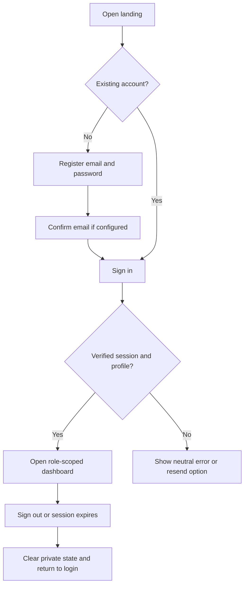
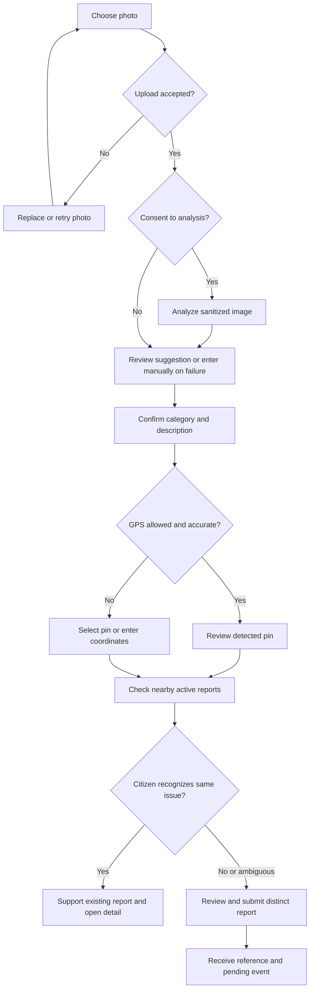
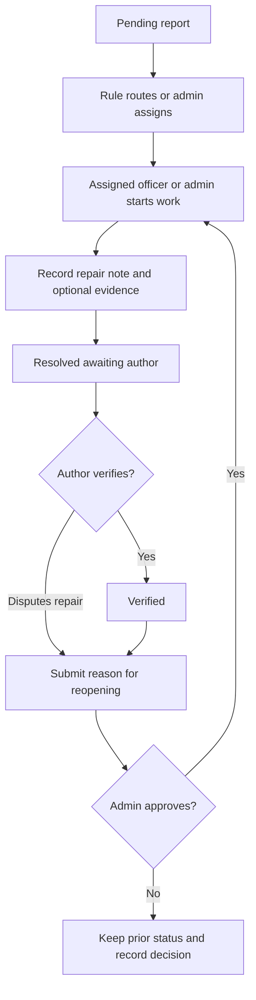

# User flows

## Entry and identity

Reject invalid email locally and server-side. Registration always provisions a citizen. Staff use the same identity provider and a separately assigned role. On expiry preserve only safe unsent fields in memory, reauthenticate and revalidate permissions before retry. Do not silently replay a mutation. Cancel subscriptions and clear private image previews on logout.

## Intake and matching

Show distance bands and category so the reporter can distinguish neighboring assets. P0 skips the matching step. If candidate lookup fails, indicate that matching is unavailable and allow filing. A failed classification leaves the category and text editable. A failed upload cannot satisfy a required photo. On validation errors focus the first invalid field. On interrupted submission reuse the submission key and reconcile against the stored result. On Supabase outage keep edits in the open form and show retry; never show a receipt before commit.

## Authority and resolution

Assignment alone leaves status pending. If unassigned, an admin can act or assign. Staff select a permitted transition and submit the displayed version; conflict reloads the latest timeline. Evidence upload precedes the resolution transaction. A failed required attachment chosen by staff leaves the draft available for retry or explicit removal. P0 permits a repair note alone. Only the original author confirms or requests reopening. No response leaves the issue resolved and unverified.

## Moderation and duplicate review

An admin opens the report, reviews sensitive content, selects hide or restore, records a reason and confirms. Hiding changes peer visibility immediately and retains staff and author access. Return forbidden when role or assignment fails, without committing any change. For a duplicate link, the source author nominates a visible active target and the admin checks both locations and versions. Preserve both histories and record the canonical reference. Reject cycles or changed targets. Intake support never creates a second report or merges one automatically. See [workflow operations](10-API-SPECIFICATION.md).
