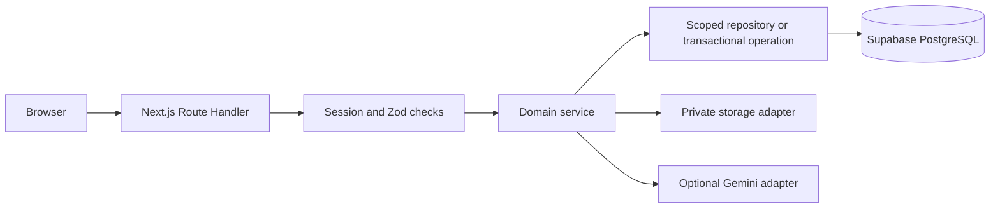

# Backend architecture

## Request path



One Node.js runtime and deployment lets one developer change the intake page, DTO and workflow in one reviewed change. Database transactions can protect report and history writes without distributed coordination. Keep the distance, routing and scoring rules pure so they can be tested or replaced independently. Route Handlers are supported in the App Router. [Next.js documentation](https://nextjs.org/docs/app/getting-started/route-handlers)

## Proposed structure and responsibilities

```text
src/app/api/
  reports/             collection, candidates and per-report operations
  admin/               assignment, reviews, analytics and export
  ai/classify/         optional image suggestion
  upload/              validated multipart intake
  departments/         active reference data
  notifications/       future inbox
  preferences/         future profile settings
src/server/
  auth/                verify session, load authoritative profile
  services/reports/    create, query and project role-safe views
  services/workflow/   transitions, assignment, history, review
  services/media/      decode, sanitize, bind and expire objects
  services/intelligence/ classify, match, route and rank
  services/analytics/  bounded aggregates and suppression
  repositories/        policy-aware reads and atomic write operations
  adapters/            Supabase clients and Gemini transport
  operations/          request IDs, quotas and structured logs
src/lib/contracts/     request and response schemas
```

## Write and read boundaries

The handler checks content type, size, same-origin mutation, verified session and shape. The service loads current role, enforces ownership or department membership and applies business rules. Write status and history in one database transaction under row lock or version predicate. If no row matches the expected version, return conflict. Route adapters translate typed failures to the common envelope. Do not leak provider exceptions.

Upload first into private staging, record uploader and expiration and bind once in a transaction. Retry or sweep orphaned objects after failed cross-system writes. Classification accepts an owned staged image ID with explicit consent. Bound latency and cost. The report creation transaction never needs an AI response. Query matching inside an approximate bounding box then use exact Haversine distance. Compute rank on read from current votes and elapsed days. See [intelligence rules](11-AI-IMPLEMENTATION.md).

Return projections designed for the specific reader. Get staff queue counts from the same scoped query used for the list. Aggregate analytics use a bounded period and suppress small geographic groups. Limit expensive reads and writes per actor using durable counters or a verified platform limiter shared across instances. Return request IDs and log duration, outcome and service error class. Exclude images, coordinates, secrets and raw descriptions.

## Failure boundaries

Database unavailable: 503 and no optimistic receipt. Object uploaded but row write failed: retry against known handle or expire orphan. Realtime disconnected: invalidate on focus or manual refresh. Version conflict: return 409 and require the client to read current state. Defer outgoing notifications until after commit with an idempotent event key. See [API](10-API-SPECIFICATION.md) and [schema](09-DATABASE-DESIGN.md).
