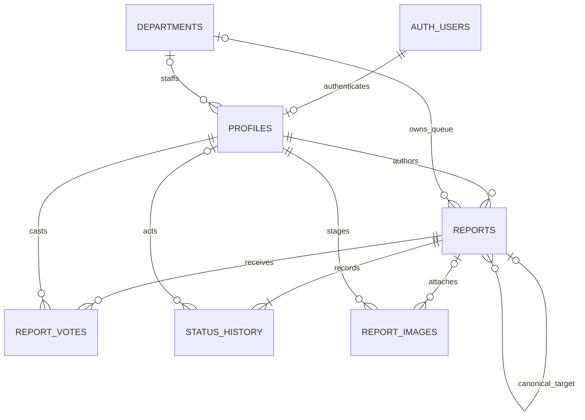

# Database design

**Historical design proposal.** The implemented Phase 02 [schema](DATABASE_SCHEMA.md) and [frontend contract](DATABASE_CONTRACT.md) supersede the column names, roles, statuses, categories, staging and score semantics below. Refer to them when building or testing.

Proposed single-campus PostgreSQL schema. No tables or migrations exist in the inspected commit. All timestamps are UTC timestamptz. UUID primary keys default to generated UUIDs except profiles.id and the composite vote key. Fields are required unless marked nullable. Short identifiers A, C, D, R and I in examples denote synthetic UUIDs for an admin, citizen, department, report and image. They are display aliases only.

## Primary relations

| Table | Columns, defaults and references | Constraints and indexes | Ownership and access | Example record (selected fields) |
|---|---|---|---|---|
| profiles | id uuid PK FK auth.users.id; display_name text; role text default citizen; department_id uuid nullable FK departments.id; locale text default en; enhanced_readability boolean default false; created_at default now() | Role citizen/officer/admin; officer needs active department; index department_id. Protected role and department changes require provisioning | Account reads own row. Preference update restricts columns. Provisioning operator owns staff grants | C, Alex, citizen, null, en, false |
| departments | id uuid PK; code text; name text; active boolean default true; service_target_hours integer nullable; created_at default now() | Unique code, positive target if set. Deactivate referenced units rather than removing them | Signed-in users read active labels; reviewed administrative seed controls writes | D, lighting, Campus lighting, true, null |
| reports | id uuid PK; reference text unique generated with CP prefix; title text (5–120 trimmed characters); author_id uuid FK profiles.id; submission_key uuid; category text; description text; latitude and longitude double precision; severity text default medium; status text default pending; department_id uuid nullable FK departments.id; publication text default private (public/private); visibility text default listed; duplicate_of uuid nullable FK reports.id; critical_ack_at timestamptz nullable; version integer default 1; created_at and updated_at default now() | Unique author_id + submission_key; description trimmed 10–1000 chars; latitude −90..90, longitude −180..180 finite; closed enums below. Index (author_id,created_at,id), (department_id,status,created_at,id), (category,status,latitude,longitude). Prevent self/cyclic links | Author owns intake. Staff control workflow. Exact coordinates, free text, identity and images limited to author/admin/current department officer | R, C, streetlight, “Lamp fails after sunset”, 12.00, 77.00, medium, pending, D, listed, v1 |
| report_votes | report_id uuid FK reports.id; voter_id uuid FK profiles.id; created_at default now(); PK (report_id,voter_id) | Unique key makes retries harmless; reverse index (voter_id,report_id). Count on read, reject additional votes on private, inactive or hidden cases | Signed-in citizen may support an accessible active report as self; expose counts only | R, C, creation timestamp |
| status_history | id uuid PK; report_id uuid FK reports.id; actor_id uuid nullable FK profiles.id; version integer; event_type text; from_status text nullable; to_status text; note text nullable; changes jsonb default empty object; created_at default now() | Unique (report_id,version); append-only; initial version 1. Server allowlists event types and change keys. Only system events may have null actor. Non-transition events repeat current status | Same transaction as version increment. Author and scoped staff read appropriate timeline, peers see only safe event type/status/time | R, C, 1, created, null, pending |
| report_images | id uuid PK; uploader_id uuid FK profiles.id; report_id uuid nullable FK reports.id; intended_report_id uuid nullable FK reports.id (required for staged evidence and checked at bind); purpose text; object_key text; mime text; byte_size integer; created_at default now(); expires_at timestamptz nullable | Unique object_key; indexes report_id and expires_at for unbound rows. Purpose intake/evidence; normalized JPEG, PNG or WebP; positive size ≤2 MB (2,000,000 bytes). Stage until attach, clear expiry when bound | Private bucket. Staged bytes visible only to uploader and authorized server processing. After attach, author and scoped staff get short-lived access | I, C, R, intake, opaque private key, image/jpeg, 240000, null expiry |

## Controlled values and consistency

Categories: pothole, garbage, streetlight, water_leakage, drainage, other. Severity: low, medium, high, critical. Status: pending, in_progress, resolved, verified. Visibility: listed or hidden. Only public, listed cases appear on the community map or receive additional votes. Active means pending or in_progress with duplicate_of null. Priority is computed, never accepted from the client. Create the report, insert the reporter’s unique initial vote, attach the owned staged intake image and insert its first event atomically. Route it in that same event when mapping exists.

For staged evidence, store intended_report_id even while report_id is null. Verify both uploader and target on attach. Cap decoded input at a proposed 16 megapixels and target ≤1 MB for mobile transfers. Keep private submissions out of all public discovery paths.

Lock affected reports in deterministic ID order during duplicate review. Allow links only to an active, visible canonical report; block links from a canonical report with incoming references to avoid chains. Exclude linked copies from active queues without deleting them, transferring votes or overwriting history. Candidate suggestions are advisory and can change between lookup and submission.

## Access enforcement

Enable RLS on each exposed relation and storage objects. Deny anonymous base-table reads. Expose only sanitized projections of explicitly public, listed cases to visitors. RLS restricts rows, so also revoke broad base-table grants; expose peer-safe database projections or narrow authorized functions for map/list fields. A peer sees reference, category, status, timestamps, approximate coordinates rounded to two decimals and counts. No email, reporter identity, notes, exact distance or photos. Direct browser mutation of workflow columns, history and protected profile fields must be denied. Privileged database functions require explicit execute grants, fixed search path and a fresh actor/scope check. Test direct API and storage access with each role.

## Additional proposed relations and operational data

| Dependency | Minimal shape and constraints | Lifecycle |
|---|---|---|
| reopen_requests (P1) | id, report_id, requester_id, reason, state pending/approved/denied, reviewer_id, decision_reason, created_at, decided_at; unique pending per report | Author submits; admin reviews with versioned event |
| duplicate_requests (P1) | id, source_id, target_id, requester_id, state, reviewer_id, created_at, decided_at; distinct IDs, unique pending per source | Source author nominates, admin validates and records decision |
| moderation_events (P1) | id, report_id, admin_id, visibility_before/after, reason, created_at | Restricted admin audit. Peer view enforces visibility |
| notifications (P2) | id, recipient_id, history_id, read_at, created_at; unique recipient_id + history_id | Recipient-only inbox; delivery provider undecided |
| quota counters | actor or privacy-preserving network key, operation, window_start, count; unique composite | Needed only if platform limiter does not meet shared limits; expire after window |

## Migration, seed and retention

Apply versioned migrations in dependency order: departments and profiles, reports, images/votes/history, transaction functions and access grants, then optional reviews. Use isolated preview, run access tests before exposing the data API, check constraints against existing rows before tightening. Use additive migrations and compatible app releases. Seed fictitious departments, two citizens, a scoped officer and admin only in test environments; provision auth identities separately. Never store reusable credentials in fixtures.

Proposed staged uploads expire after one hour; run a cleanup pass that rechecks attachment before deletion. Reconcile private bucket objects with metadata and log counts. Decide live retention, lawful access and deletion workflow with the institution before accepting real resident data. Use synthetic records in the meantime. See [privacy](12-SECURITY-AND-PRIVACY.md) and [operations](16-DEPLOYMENT-PLAN.md).
