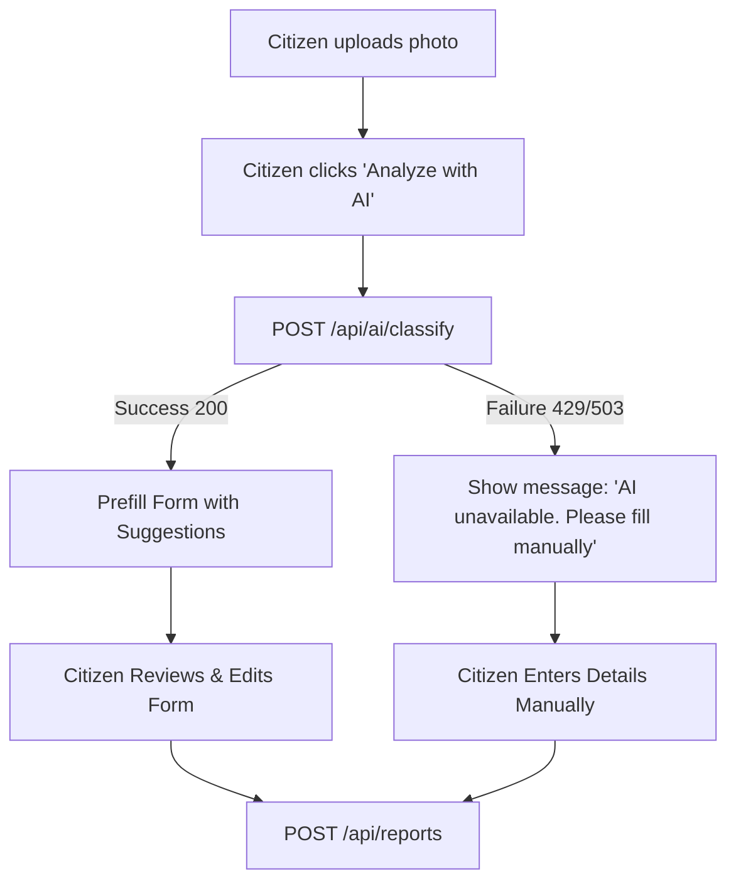

# CivicPulse AI Classification Contract · Phase 11

> **Document Version**: 1.0.0  
> **Status**: Verified & Ready for Frontend Integration  
> **Target Audience**: Frontend Engineers, AI Integration Leads, Security Testers  
> **Backend Branch**: `backend`  

---

## 1. Overview & Core Philosophy

CivicPulse utilizes Google Gemini AI (`@google/genai` SDK) to assist citizens by analyzing uploaded photographs and suggesting structured complaint information.

> [!IMPORTANT]
> **Human-in-the-Loop Principle**: AI suggestions are strictly advisory. The AI **never** automatically creates complaints, assigns departments, updates complaint statuses, or calculates official priority scores. The citizen reviews, edits, and submits the final complaint via `POST /api/reports`.

---

## 2. Endpoint Specification

- **Endpoint**: `POST /api/ai/classify`
- **Method**: `POST`
- **Authentication**: Required (`requireUser()`). Authenticated citizen or admin session via HTTP-only SSR cookies.
- **Content-Type**: `application/json`

---

## 3. Prerequisite: Staging Image Upload

Before calling `/api/ai/classify`, the citizen must stage an image using the Phase 05 upload endpoint:

1. `POST /api/upload` with `multipart/form-data` (`file: File`).
2. Server validates MIME type, magic bytes, and size (max 5MB).
3. Server returns `{ "data": { "image_path": "drafts/<user_id>/<image_uuid>.<ext>" } }`.
4. Use this `image_path` in `/api/ai/classify`.

---

## 4. Request Schema (`aiClassifySchema`)

### JSON Request Body

```json
{
  "image_path": "drafts/11111111-1111-4111-8111-111111111111/12345678-1234-4234-8234-123456789abc.jpg",
  "description_hint": "Water has been leaking across the sidewalk since morning.",
  "consent_to_ai_processing": true
}
```

### Field Definitions

| Field | Type | Required | Constraints | Description |
| :--- | :--- | :--- | :--- | :--- |
| `image_path` | `string` | **Yes** | Must match `^drafts/<user_id>/<uuid>.<ext>$` | The owned draft image in private storage. No URLs or path traversals. |
| `consent_to_ai_processing` | `boolean` | **Yes** | Must be strictly `true` | Affirmative consent from the citizen to send image bytes to Google Gemini. |
| `description_hint` | `string` | No | Max 1000 characters | Optional citizen context hint to assist the model. |

> [!CAUTION]
> **Strict Validation**: Injecting client-controlled authority fields (`user_id`, `role`, `status`, `priority_score`, `assigned_by`, `department_id`) is strictly rejected with HTTP 422 `VALIDATION_ERROR`.

---

## 5. Success Response Contract

- **HTTP Status**: `200 OK`
- **Cache-Control**: `no-store`

### Example Response Body

```json
{
  "success": true,
  "data": {
    "category": "pothole",
    "severity": "medium",
    "title_suggestion": "Deep pothole on Main Street vehicular lane",
    "description_suggestion": "The photograph shows a significant asphalt depression in the roadway that may pose a hazard to passing vehicles.",
    "department_suggestion": "Road Maintenance",
    "evidence_summary": "Visible circular asphalt depression with broken edges.",
    "confidence_level": "high",
    "needs_manual_review": false,
    "uncertainty_reason": null
  },
  "message": "AI suggestions generated successfully"
}
```

### Response Field Reference

| Field | Type | Description | Frontend UI Usage |
| :--- | :--- | :--- | :--- |
| `category` | `string` (enum) | Canonical civic category | Preselects category dropdown |
| `severity` | `string` (enum) | Suggested advisory severity (`low`, `medium`, `high`, `critical`) | Displays as advisory guidance |
| `title_suggestion` | `string` (5–120 chars) | Factual, concise title | Prefills editable title input |
| `description_suggestion` | `string` (10–2000 chars) | Neutral, factual description | Prefills editable description textarea |
| `department_suggestion` | `string \| null` | Recommended department from approved directory | Displays as non-binding recommendation |
| `evidence_summary` | `string` (5–500 chars) | Summary of visible features | Displays in AI review card |
| `confidence_level` | `"low" \| "medium" \| "high"` | Model-expressed qualitative confidence | Indicates whether evidence was unambiguous |
| `needs_manual_review` | `boolean` | True if image is blurry, ambiguous, or non-civic | Triggers warning prompt to citizen |
| `uncertainty_reason` | `string \| null` | Explanation of limitations or missing evidence | Shown in warning banner if present |

---

## 6. Canonical Values

### 6.1 Categories (`ReportCategory`)
- `"pothole"`: Road surface holes, asphalt cracks, craters.
- `"garbage"`: Waste dumping, overflow, litter.
- `"water_leakage"`: Broken pipes, leaking municipal water lines.
- `"streetlight"`: Broken lamp fixtures, dangling wires.
- `"drainage"`: Blocked stormwater drains, overflowing sewers.
- `"damaged_infrastructure"`: Broken sidewalks, guardrails, bridges.
- `"other"`: Non-civic, ambiguous, or unlisted issues.

### 6.2 Severities (`ReportSeverity`)
- `"low"`: Minor cosmetic or low-impact defects.
- `"medium"`: Routine visible municipal maintenance need.
- `"high"`: Significant hazard to vehicles or pedestrians.
- `"critical"`: Severe immediate safety risk (e.g., exposed high-voltage cables, large sinkhole).

### 6.3 Approved Municipal Departments
- `"Road Maintenance"`
- `"Sanitation"`
- `"Water Supply"`
- `"Electrical"`
- `"Drainage"`
- `"Public Works"`
- `null`: No confident recommendation.

---

## 7. Error Handling & HTTP Status Codes

All errors return the standard CivicPulse envelope: `{ "success": false, "error": { "code": string, "message": string } }`.

| Status | Code | Cause | User Guidance Recommendation |
| :--- | :--- | :--- | :--- |
| `400` | `VALIDATION_ERROR` | Malformed JSON request body | "Invalid request format." |
| `401` | `UNAUTHORIZED` | User not authenticated | "Please log in to use AI analysis." |
| `403` | `FORBIDDEN` | Missing AI consent or analyzing another user's draft | "You must provide consent or own this draft." |
| `404` | `NOT_FOUND` | Draft image does not exist in storage | "Evidence image not found. Please re-upload." |
| `413` | `VALIDATION_ERROR` | Image exceeds 5MB limit | "Image file is too large (max 5MB)." |
| `422` | `VALIDATION_ERROR` | Schema validation error (e.g., traversal, invalid fields) | "Please check your request parameters." |
| `429` | `RATE_LIMITED` | AI rate limit reached | "AI rate limit reached. You can fill out the form manually." |
| `503` | `SERVICE_UNAVAILABLE` | Gemini API key unconfigured or provider unavailable | "AI suggestions are temporarily unavailable. Please fill out the form manually." |
| `500` | `INTERNAL_SERVER_ERROR` | Unexpected server failure | "Something went wrong. Please proceed manually." |

---

## 8. Graceful Degradation & Manual Fallback

If the AI service fails or returns an error (such as `503 SERVICE_UNAVAILABLE` or `429 RATE_LIMITED`), the frontend **must not block the citizen**:



---

## 9. Ready-to-Use Frontend Integration Hook

```typescript
// src/hooks/useAIClassification.ts
import { useMutation } from "@tanstack/react-query";
import type { AIClassifyInput, AIClassificationData } from "@/types/ai";

export function useAIClassification() {
  return useMutation<AIClassificationData, Error, AIClassifyInput>({
    mutationFn: async (payload) => {
      const res = await fetch("/api/ai/classify", {
        method: "POST",
        headers: { "Content-Type": "application/json" },
        body: JSON.stringify(payload),
        credentials: "include",
      });

      const json = await res.json();
      if (!res.ok || !json.success) {
        throw new Error(json.error?.message || "Failed to analyze image with AI");
      }

      return json.data;
    },
  });
}
```
