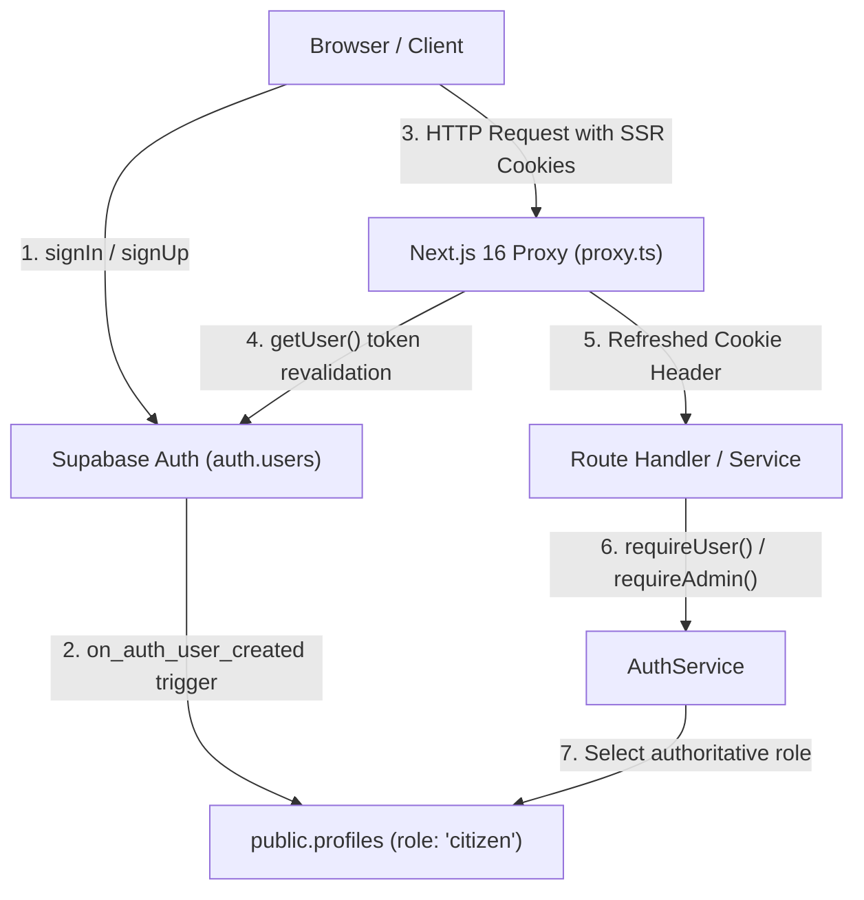

# CivicPulse Authentication & RBAC Architecture · Phase 04

## 1. Supabase Auth Architecture

CivicPulse uses Supabase Auth as its single, authoritative identity provider. The architecture cleanly separates authentication identity from application authorization:

- **Supabase Auth (`auth.users`)**: Manages identity creation, credentials (passwords), email verification, session tokens (JWT access tokens and refresh tokens), and recovery links.
- **Application Database (`public.profiles`)**: Stores domain-specific user information: `full_name`, `role` (`'citizen' | 'admin'`), and timestamps.
- **Next.js Backend (App Router)**: Performs request-scoped session verification, authoritative role lookup, and route authorization using server-side SDK methods.



---

## 2. Authentication Flow

### Citizen Registration
1. User provides `full_name`, `email`, and `password`.
2. Input is validated by `registerSchema` (enforcing length, format, and rejecting surrounding whitespace).
3. The frontend invokes `supabase.auth.signUp()`.
4. Supabase Auth creates the `auth.users` row.
5. The `on_auth_user_created` trigger automatically provisions a `public.profiles` row with:
   - `id = auth.users.id`
   - `full_name = safe_name`
   - `role = 'citizen'` (user-supplied role metadata is strictly ignored).
6. If email confirmation is enabled, Supabase sends a confirmation email.

### Citizen / Admin Login
1. User enters `email` and `password`.
2. Supabase Auth authenticates credentials via `signInWithPassword()`.
3. Standard SSR session cookies (`sb-<ref>-auth-token`) are set on the browser domain.
4. Subsequent server requests carry these cookies.

---

## 3. Session Management & SSR Cookie Handling

We utilize `@supabase/ssr` (version 0.12.7) for cookie-based session management across the Next.js App Router:
- **Browser Client (`src/lib/supabase/client.ts`)**: Created via `createBrowserClient()`, using the public Supabase URL and Publishable/Anon key.
- **Server Client (`src/lib/supabase/server.ts`)**: Created via `createServerClient()`, reading from `cookies()` (asynchronous in Next.js 16). In Route Handlers, mutable response headers persist refreshed cookie headers.
- **Token Revalidation**: All server-side checks call `supabase.auth.getUser()`, which validates the access token directly with the Supabase Auth server. `getSession()` alone is never treated as authorization proof on the server.

---

## 4. Next.js 16 Version Compatibility

In Next.js 16 (installed version: 16.4.6), the Middleware convention was renamed to **Proxy**:
- Convention file: `src/proxy.ts`
- Named export: `export async function proxy(request: NextRequest) { ... }`
- Matching config: Filters out `_next/static`, `_next/image`, `favicon.ico`, and static media.
- Purpose: Invokes `updateSession(request)` to refresh expired access tokens using the refresh token before Server Components render, attaching updated cookies to both request and response headers.
- Route Guarding: Proxy performs optimistic redirection (redirecting unauthenticated users visiting `/dashboard`, `/admin` to `/login?redirectTo=...`). Handlers and services enforce strict independent authorization.

---

## 5. Profile Synchronization & Auto-Provisioning

Database migration `20261121000300_phase04_auth_profile_sync.sql` establishes:
1. **Trigger `on_auth_user_created`**: Runs `civicpulse_private.handle_new_user()` as a `SECURITY DEFINER` function with `search_path = ''`. It inserts a new row into `public.profiles` with `role = 'citizen'`.
2. **Missing Profile Repair `civicpulse_ensure_profile()`**: An idempotent `SECURITY DEFINER` function callable by `authenticated`. If an authenticated account is missing its profile (e.g. created prior to the trigger), `getCurrentProfile()` calls this RPC to safely provision a default `citizen` profile for `auth.uid()`.
3. **Escalation Prevention**: The trigger and repair functions hardcode `role = 'citizen'`. User metadata or API request payloads cannot grant `'admin'` privileges.

---

## 6. Role-Based Access Control (RBAC)

Two roles exist in the system:
- `citizen`: Default role. Can view public reports, submit reports, vote, and view own history.
- `admin`: Administrative role. Can triage reports, update status, change departments, assign severity, and moderate content.

### Server Authorization Helpers (`src/services/auth.service.ts`)
- `getCurrentUser()`: Returns verified `AuthenticatedUser | null`.
- `requireUser()`: Ensures valid authenticated identity; throws HTTP 401 `UNAUTHORIZED` if missing or expired.
- `requireAdmin()`: Enforces admin privileges; throws HTTP 401 if unauthenticated and HTTP 403 `FORBIDDEN` if the caller is a citizen. Authoritative role is fetched from `public.profiles`, never trusted from client headers or JWT claims.
- `assertAdmin()`: TypeScript assertion utility in `src/utils/permissions.ts`.

---

## 7. Admin Provisioning

Public registration can never create an administrator. To provision the initial administrator in a development or production environment:
1. Create an Auth account via Supabase Dashboard or standard signup.
2. In Supabase Dashboard SQL Editor (or direct privileged psql connection), execute:
   ```sql
   update public.profiles
   set role = 'admin'
   where id = '<target-user-uuid>';
   ```
3. The change takes effect immediately on the next server request, because `requireAdmin()` inspects the live database role.

---

## 8. Email Confirmation & Password Recovery

### Email Confirmation
- Supabase sends an email containing a link to `/auth/confirm?token_hash=...&type=signup&next=/dashboard`.
- `src/app/auth/confirm/route.ts` verifies the OTP using `supabase.auth.verifyOtp()`.
- Upon successful verification, the session is established and the user is redirected to the sanitized `next` URL.
- If verification fails or tokens expire, the user is redirected to `/login?error=invalid_or_expired_token`.

### Password Recovery
- User submits email to `supabase.auth.resetPasswordForEmail(email, { redirectTo: `${origin}/auth/confirm?next=/reset-password` })`.
- Recovery link opens `/auth/confirm?token_hash=...&type=recovery&next=/reset-password`.
- The handler verifies the token and establishes the recovery session, redirecting to `/reset-password`.
- The user submits a new password via `supabase.auth.updateUser({ password })`.

---

## 9. Redirect Security & Open Redirect Prevention

All redirect parameters (`redirectTo`, `next`) are validated by `sanitizeRedirectUrl()`:
- Rejects protocol-relative URLs (`//evil.com`).
- Rejects external schemes (`https://evil.com`, `http://...`).
- Rejects script/data schemes (`javascript:...`).
- Rejects Windows backslash paths (`\evil.com`).
- Accepts only safe relative pathnames beginning with `/` on the same origin.
- Defaults safely to `/dashboard` (or `/reset-password` for recovery).

---

## 10. API Route Inventory

| Route | Method | Access | Description |
|---|---|---|---|
| `/api/auth/me` | GET | Authenticated (`requireUser`) | Returns `{ user: { id, email, full_name, role } }`. Cache-Control: `no-store`. |
| `/api/auth/logout` | POST | Authenticated / Public | Clears Supabase session and removes SSR cookies. |
| `/auth/confirm` | GET | Public | Validates email confirmation or recovery tokens and redirects to internal route. |
