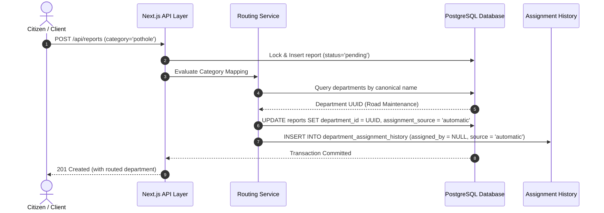

# CivicPulse Automatic Department Routing Architecture (Phase 15)

## 1. Architectural Overview

The CivicPulse Automatic Department Routing Engine is designed to bridge initial citizen complaint submission and municipal departmental workflows. It provides deterministic, zero-touch dispatch of civic infrastructure issues to their responsible simulated departments while safeguarding human administrative decisions.



---

## 2. Core Architectural Principles

### 2.1 Determinism & Source of Truth
The canonical source of truth for category-to-department mappings resides in `src/config/routing.ts` (application tier) and is mirrored in PostgreSQL stored procedures (`civicpulse_auto_route_report`, `civicpulse_create_report`).
Mappings are 1:1, explicit, and versioned (`ROUTING_RULE_VERSION = "v1"`).

### 2.2 Dynamic Entity Resolution
Department identifiers (`UUID v4`) are never hardcoded. When mapping `pothole` to `Road Maintenance`, the engine performs an indexed database lookup against `public.departments.name`. If a department has not yet been seeded or was renamed, the engine gracefully skips assignment (`target_department_missing`), ensuring invalid foreign keys are never written.

### 2.3 Manual Admin Override Precedence
Municipal staff may deliberately override an automatic assignment (e.g. reassigning a water-related road collapse from `Road Maintenance` to `Water Supply`), or intentionally unassign a complaint for triage (`department_id = null`).
To preserve human authority:
1. Every manual assignment via `POST /api/admin/assign` sets `reports.manual_override = true` and `reports.assignment_source = 'manual'`.
2. Any subsequent automatic routing check (such as cron jobs, retry endpoints, or backfill scripts) queries `manual_override`. If `true`, the operation immediately halts with status `skipped_manual_override`.
3. Server restarts or stateless HTTP cycles cannot reset or lose the override flag because it is durably persisted in `public.reports`.

### 2.4 True System Actor Representation
An automatic assignment is a software system action without a human actor.
- In earlier phases, `department_assignment_history.assigned_by` was defined as `uuid not null references public.profiles(id)`.
- Fabricating a fake user UUID or attributing system routing to the citizen creator violates audit integrity and database foreign keys.
- Phase 15 modifies `department_assignment_history.assigned_by` to be nullable (`drop not null`), explicitly records `assignment_source = 'automatic'`, and populates `rule_key` (e.g. `'pothole_to_road_maintenance'`).

---

## 3. Concurrency Protection & Transaction Safety

### 3.1 Row-Level Locking (`FOR UPDATE`)
During routing execution in `civicpulse_auto_route_report`:
```sql
SELECT * INTO target_report FROM public.reports WHERE id = p_report_id FOR UPDATE;
```
This serializes concurrent routing attempts, preventing race conditions between concurrent automated tasks and human administrators.

### 3.2 Concurrency Scenarios & Resolution

| Concurrent Events | Winner / Resolution | Architectural Mechanism |
|---|---|---|
| Admin manually assigns while automated routing executes | Admin assignment wins | `reports.manual_override = true` causes auto-routing to abort |
| Two simultaneous automatic routing triggers | First commits; second is a no-op | `FOR UPDATE` lock + `target_report.department_id = target_dept.id` checks |
| Admin intentionally unassigns while auto-routing retries | Unassigned state preserved | `reports.manual_override = true` prevents re-routing despite `department_id IS NULL` |
| Citizen submits report while department is missing | Report created unassigned | Fail-open design: report persists; routing deferred for manual review |

---

## 4. Lifecycle Integration & State Machine Compatibility

1. **Status Invariant**: Automatic routing never alters `reports.status`. Newly submitted reports remain `pending`.
2. **Priority Score Invariant**: Automatic routing never alters `reports.priority_score`. Scoring remains strictly governed by Phase 14 (`calculateInitialPriority`).
3. **Resolved Complaint Protection**: Once a report reaches `status = 'resolved'`, automatic routing is frozen (`skipped_resolved`).

---

## 5. Backfill Architecture

For pre-existing complaints submitted before Phase 15 activation:
`backfillUnassignedReports(client)`:
1. Queries candidate complaints with `department_id IS NULL`, `manual_override = false`, and `status != 'resolved'`.
2. Iterates over candidates and calls `autoRouteReport` for each.
3. Automatically skips `other` categories, resolved reports, and manually handled reports.
4. Guaranteed to be 100% idempotent: running the backfill twice results in 0 mutations on the second pass.
