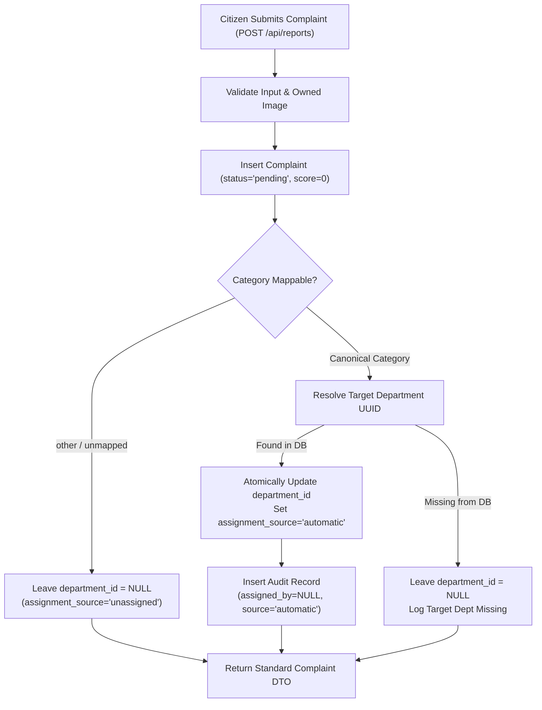

# CivicPulse Automatic Department Routing Contract (Phase 15)

This document provides the definitive integration and API contract for frontend and backend engineers consuming the automatic department routing engine, deterministic category-to-department mappings, manual administrative override protections, and routing retry endpoints in CivicPulse.

---

## 1. System Overview & Core Objectives

CivicPulse automatically routes newly submitted civic complaints to their responsible operational departments based on canonical categories.

Key guarantees:
1. **Deterministic Mapping**: Strict, rule-based category-to-department assignment.
2. **Dynamic Database Resolution**: Department UUIDs are resolved dynamically from `public.departments` by name; never hardcoded.
3. **Manual Override Precedence**: Manual administrator assignments or intentional unassignments take absolute precedence and cannot be overwritten by automatic routing.
4. **Transparent Audit History**: Every routing action writes an immutable audit record to `public.department_assignment_history` with `assigned_by: null` and `assignment_source: "automatic"`.
5. **Fail-Open Citizen Submission**: Inability to route (e.g. missing department seed or `other` category) never prevents complaint submission; the complaint remains unassigned (`department_id: null`) for administrative review.
6. **Optimistic Concurrency & Idempotency**: Repeated routing attempts for a complaint already assigned to the target department return a clean no-op without duplicating audit history.

---

## 2. Authoritative Category-to-Department Mapping

The platform enforces the following official canonical mapping:

| Complaint Category | Canonical Target Department | Routing Action | Explanation / Rationale |
|---|---|---|---|
| `pothole` | `Road Maintenance` | Automatic Assignment | Pavement depressions, potholes, broken tarmac |
| `garbage` | `Sanitation` | Automatic Assignment | Waste accumulation, overflowing bins, debris |
| `water_leakage` | `Water Supply` | Automatic Assignment | Pipe bursts, leaking hydrants, main line leaks |
| `streetlight` | `Electrical` | Automatic Assignment | Non-functioning lamps, exposed wiring, dark walkways |
| `drainage` | `Drainage` | Automatic Assignment | Clogged culverts, storm drains, monsoon pooling |
| `damaged_infrastructure` | `Public Works` | Automatic Assignment | Broken guardrails, collapsed masonry, park benches |
| `other` | *None* (`null`) | Manual Review | Ambiguous or multifaceted civic issues |

> [!IMPORTANT]
> - Category matching is strictly canonical and exact.
> - The category `other` is never automatically routed; it remains unassigned (`department_id: null`) with `assignment_source: "unassigned"`.
> - AI Gemini suggestions (Phase 11) remain strictly advisory; only the verified complaint category governs automatic routing.

---

## 3. Complaint Lifecycle & Routing Trigger Points



---

## 4. API Endpoints

### 4.1 Administrative Routing Retry: `POST /api/admin/route`

Allows authorized municipal administrators to retry or re-evaluate automatic routing on an existing complaint (e.g. following category edits, missing department additions, or failed initial routing).

- **Method**: `POST`
- **URL**: `/api/admin/route`
- **Authentication**: Required (Valid Supabase session)
- **Authorization**: Strict `admin` role required (`assertAdmin`)
- **Headers**:
  ```http
  Content-Type: application/json
  ```
- **Response Cache Header**: `Cache-Control: no-store`

#### Request Payload Schema

```json
{
  "report_id": "77777777-7777-4777-8777-777777777777",
  "expected_department_id": null
}
```

| Field | Type | Required | Description |
|---|---|---|---|
| `report_id` | `string` (UUID v4) | Yes | Target complaint identifier |
| `expected_department_id` | `string` (UUID v4) or `null` | Optional | Optimistic concurrency lock. If provided, routing fails if current department differs. |

#### Forbidden Client Fields

The request schema is strict. Any attempt to supply the following fields returns HTTP 422:
- `department_id` (Admins wishing to manually assign must use `POST /api/admin/assign`)
- `assignment_source`
- `manual_override`
- `role`
- `status`

#### Response Payloads

##### A. Successful Automatic Assignment (HTTP 200)

```json
{
  "success": true,
  "data": {
    "report_id": "77777777-7777-4777-8777-777777777777",
    "routing_status": "assigned",
    "assignment_source": "automatic",
    "department": {
      "id": "11111111-0000-4000-8000-000000000001",
      "name": "Road Maintenance"
    },
    "previous_department_id": null,
    "rule_key": "pothole_to_road_maintenance",
    "assignment_history_id": "88888888-8888-4888-8888-888888888888",
    "assigned_at": "2026-11-22T00:15:00.000Z",
    "message": "Complaint routed successfully"
  },
  "message": "Complaint routed successfully"
}
```

##### B. Skipped: Manual Override Precedence (HTTP 200)

Returned when an administrator has previously assigned or intentionally unassigned the complaint.

```json
{
  "success": true,
  "data": {
    "report_id": "77777777-7777-4777-8777-777777777777",
    "routing_status": "skipped_manual_override",
    "assignment_source": "manual",
    "department": {
      "id": "11111111-0000-4000-8000-000000000006",
      "name": "Public Works"
    },
    "previous_department_id": "11111111-0000-4000-8000-000000000006",
    "message": "Complaint is protected by administrator manual override"
  },
  "message": "Complaint is protected by administrator manual override"
}
```

##### C. Skipped: Already Assigned (Idempotent No-Op, HTTP 200)

```json
{
  "success": true,
  "data": {
    "report_id": "77777777-7777-4777-8777-777777777777",
    "routing_status": "skipped_already_assigned",
    "assignment_source": "automatic",
    "department": {
      "id": "11111111-0000-4000-8000-000000000001",
      "name": "Road Maintenance"
    },
    "previous_department_id": "11111111-0000-4000-8000-000000000001",
    "rule_key": "pothole_to_road_maintenance",
    "message": "Complaint is already assigned to the target department"
  },
  "message": "Complaint is already assigned to the target department"
}
```

##### D. Skipped: Category `other` (Manual Review, HTTP 200)

```json
{
  "success": true,
  "data": {
    "report_id": "77777777-7777-4777-8777-777777777777",
    "routing_status": "skipped_unmapped",
    "assignment_source": "unassigned",
    "department": null,
    "previous_department_id": null,
    "message": "Category requires manual administrator review"
  },
  "message": "Category requires manual administrator review"
}
```

---

## 5. Error Responses

| HTTP Status | Error Code | Scenario | Message |
|---|---|---|---|
| `401 Unauthorized` | `UNAUTHORIZED` | No session or invalid token | "Authentication required" |
| `403 Forbidden` | `FORBIDDEN` | Citizen caller attempts to route | "Administrative privileges required" |
| `404 Not Found` | `NOT_FOUND` | `report_id` does not exist | "Report not found" |
| `409 Conflict` | `CONFLICT` | `expected_department_id` mismatch | "Complaint department state conflict. Expected [X] but found [Y]" |
| `422 Unprocessable` | `VALIDATION_ERROR` | Malformed JSON or invalid UUID | Validation error description |
| `500 Server Error` | `INTERNAL_SERVER_ERROR` | Database failure | "Failed to execute automatic routing" |

---

## 6. Frontend UI Guidance

1. **Complaint Submission Screen**:
   - When a citizen selects `pothole`, the UI may display: *"Assigned to: Road Maintenance (Automatic)"*.
   - When a citizen selects `other`, the UI should indicate: *"Routing: Will be routed after staff review"*.
2. **Admin Complaint Detail View**:
   - Display department badge alongside `assignment_source` (`Automatic` vs `Manual`).
   - If `assignment_source === "manual"` or `manual_override === true`, show an indicator: *"Manual Assignment (Protected from auto-routing)"*.
   - Provide standard department reassignment dropdown targeting `POST /api/admin/assign`.
