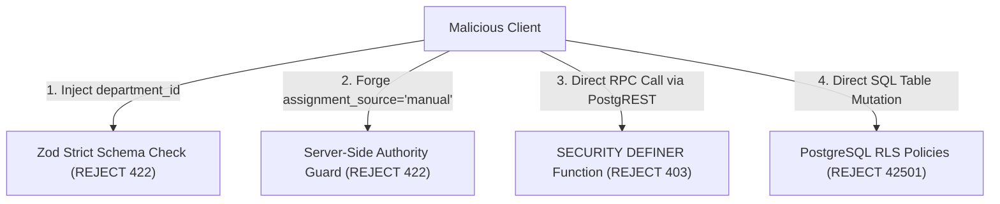

# CivicPulse Automatic Department Routing Security (Phase 15)

## 1. Threat Model & Security Posture

Automatic department routing executes privileged modifications on complaint assignments and audit trails. Without strict defensive controls, malicious actors could attempt to misroute sensitive complaints, overwrite administrative assignments, forge system audit events, or bypass municipal oversight.



---

## 2. Defensive Controls & Mitigation Analysis

### 2.1 Prevention of Injected Authority Fields
- **Vulnerability**: An attacker submits `department_id` or `assignment_source: "manual"` during report creation (`POST /api/reports`) or admin retry (`POST /api/admin/route`).
- **Mitigation**:
  - `createReportSchema` in `src/validators/report.schema.ts` strictly permits only citizen fields (`title`, `description`, `category`, `latitude`, `longitude`, `image_path`, `severity`). Any extra keys trigger schema rejection.
  - `adminRouteReportSchema` in `src/validators/routing.schema.ts` defines `.strict()`, disallowing any fields other than `report_id` and optional `expected_department_id`.
  - `routingForbiddenFieldsSchema` explicitly tests and blocks client injection of `assignment_source`, `manual_override`, and `department_id`.

### 2.2 Privilege Escalation & RPC Defense
- **Vulnerability**: A citizen or anonymous user invokes `civicpulse_auto_route_report` directly via PostgREST RPC.
- **Mitigation**:
  - The function enforces Layer 1 authorization:
    ```sql
    is_svc := (coalesce(auth.role(), '') = 'service_role');
    if not is_svc then
      if caller_uid is null then
        raise exception 'UNAUTHORIZED: Authentication required' using errcode = '28000';
      end if;
      select role into caller_role from public.profiles where id = caller_uid;
      if caller_role is null or caller_role <> 'admin' then
        raise exception 'FORBIDDEN: Administrative or service privileges required' using errcode = '42501';
      end if;
    end if;
    ```
  - Anonymous and citizen execution is explicitly revoked (`revoke all on function ... from public, anon`).

### 2.3 SQL Injection & Search Path Hijacking
- **Vulnerability**: Mutable `search_path` allows attackers to intercept table references via schema poisoning.
- **Mitigation**:
  - All stored functions (`civicpulse_auto_route_report`, `civicpulse_assign_department`, `civicpulse_create_report`) are compiled with `set search_path = ''`.
  - All object identifiers are fully schema-qualified (`public.reports`, `public.departments`, `public.department_assignment_history`).

### 2.4 System Actor Non-Repudiation
- **Vulnerability**: Attributing automatic routing to an arbitrary user ID or creating fictitious user accounts to satisfy audit foreign keys.
- **Mitigation**:
  - `department_assignment_history.assigned_by` is nullable.
  - Automatic assignments explicitly set `assigned_by = NULL` and `assignment_source = 'automatic'`.
  - Manual assignments set `assigned_by = current_uid` and `assignment_source = 'manual'`.
  - Auditors can distinguish human decisions from system routing without ambiguity.

### 2.5 Manual Override Durability & Anti-Tampering
- **Vulnerability**: Automated routing scripts, retries, or backfills revert an administrator's intentional manual department correction.
- **Mitigation**:
  - `reports.manual_override = true` is permanently stored in the database.
  - Automatic routing aborts immediately (`skipped_manual_override`) whenever `manual_override = true` or `assignment_source = 'manual'`.
  - Only authorized administrators invoking Phase 09 `POST /api/admin/assign` can reassign or clear manual assignments.
