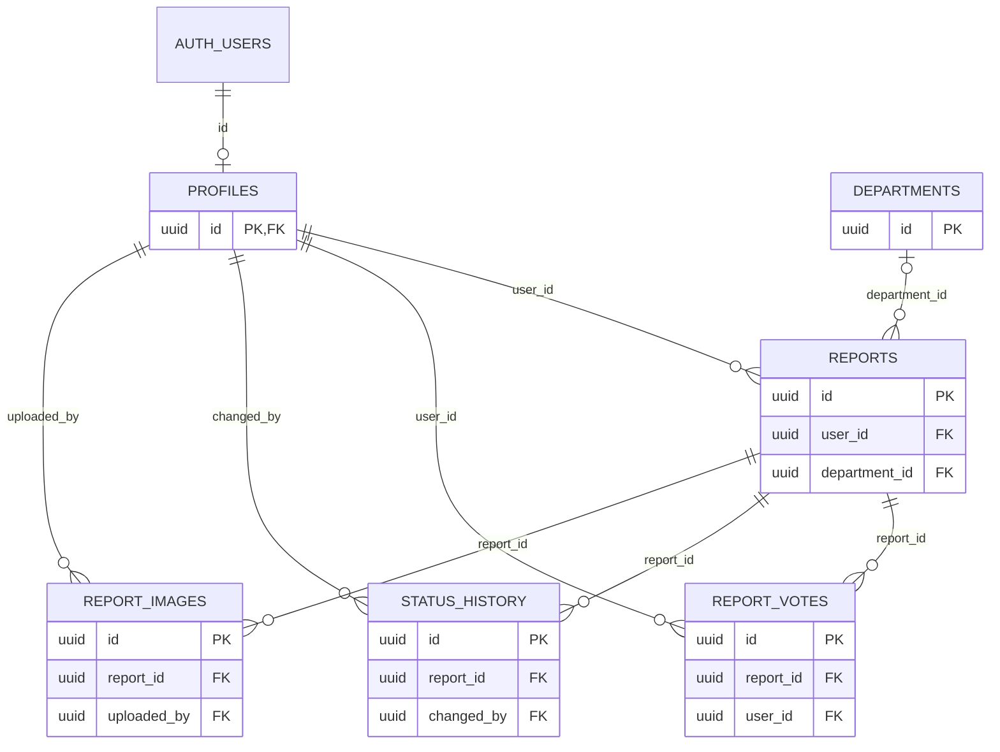

# CivicPulse database schema · Phase 02

**Implementation evidence.** One transactional migration, six application tables in public, one timestamp function and three triggers. Applied and tested on isolated PostgreSQL 18.7 (PGlite 0.5.17) with a minimal Auth identity table and roles. Hosted Supabase application and connectivity have not been verified. The migration and this contract take precedence over the [earlier proposed design](09-DATABASE-DESIGN.md).

## Relationships

## Column dictionary

Each table has an **id UUID primary key**. Profiles use the matching Auth ID; other tables default to gen_random_uuid(). All tables have **created_at timestamptz NOT NULL DEFAULT now()**. Nullable columns are explicitly marked below. All other inputs are required unless generated or defaulted.

| Table | Additional columns and constraints |
|---|---|
| profiles | id references auth.users.id. full_name text, 1–120 characters with no surrounding whitespace. role text defaults to citizen; citizen/admin only. updated_at timestamptz defaults to now(). Auth owns email; no duplicate or public contact field. |
| departments | name text, 1–120, no surrounding whitespace, unique on lower(name). Internal spaces remain significant. description text nullable. updated_at timestamptz defaults to now(). Directory entries represent simulated departments. |
| reports · identity and intake | reference text generated as CP- followed by the complete UUID, unique. submission_key uuid unique per user_id for retry reconciliation. user_id uuid references profiles; department_id uuid nullable references departments. title text 5–120, description text 10–1000, both trimmed. category text from the seven-value [contract](DATABASE_CONTRACT.md). latitude and longitude double precision, inclusive limits ±90 and ±180 respectively. |
| reports · lifecycle | severity text default medium; status text default pending. publication text public/private default private; visibility text listed/hidden default listed. priority_score integer 0–100 default 0 (uncalculated). version integer ≥1 default 1. updated_at timestamptz defaults to now(). resolved_at timestamptz nullable; required only in resolved state and must be on or after creation. Reopen clears it in the same statement as the status change. |
| report_votes | report_id uuid references reports, user_id uuid references profiles; unique pair (report_id,user_id). Derive totals by counting rows. |
| status_history | report_id uuid references reports; version integer ≥1, unique per report. status text required; previous_status text nullable for initial event. Both use the report status vocabulary. changed_by uuid references profiles. notes text nullable, max 1000, private. |
| report_images | report_id uuid references reports; uploaded_by uuid references profiles. type text before/after. storage_path text unique, 1–512 ASCII characters; relative opaque key with letters, digits, underscores, hyphens, dots and directory separators; no URL, leading slash, trailing slash, empty or traversal segment. Only metadata is stored. |

The three timestamp triggers preserve created_at and refresh updated_at. Phase 03 also advances report versions and records history automatically.

## Query indexes

All primary keys and unique constraints create indexes. The report reference supports case lookup, (user_id,submission_key) reconciles retries, lower(name) enforces directory uniqueness, (report_id,user_id) supports vote counts, (report_id,version) gives ordered history without timestamp ties, and storage_path identifies an object.

| Index | Query it supports |
|---|---|
| reports_creator_recent | Per-author feed by descending creation time and ID |
| reports_department_status | Assigned and unassigned work by department and status |
| reports_status_priority | Queue within one status, highest stored priority then oldest report and ID |
| reports_category_location | Category/status candidate prefilter and coordinate bounds; longitude can be a residual filter after latitude range |
| reports_recent | Chronological list across categories/statuses |
| report_votes_user | Issues a person supported |
| report_images_report | A report's before/after images in creation order |

Plan and measure multi-status and geographic queries with realistic data before adding more indexes. PostGIS and Haversine business logic are outside this migration.

## Security and retention

Phase 02 initially enabled RLS and revoked ordinary client grants. After Phase 03, the [access matrix](ACCESS_CONTROL_MATRIX.md) defines the active policies, column privileges, projections and operator boundaries.

All nine foreign keys use ON DELETE RESTRICT and default ON UPDATE NO ACTION. Treat referenced IDs as immutable. Department removal requires reassignment or unassignment first. Retain reports and history; withhold citizen deletion access. A profile blocks deleting its Auth row, and existing child records block deleting parent records. Decide retention duration and an authorized anonymization/deletion process before accepting live data. An approved account deletion must address related media and audit data explicitly.

## Apply with the Supabase website

Use the [Dashboard setup guide](SUPABASE_DASHBOARD_SETUP.md) for the two migrations, department seed, all three tests and recovery from existing-table errors.

## Service handoff

After Phase 03 the database trigger is the single writer for the initial author vote and report history. Future services must atomically attach media and enforce expected versions and valid transitions. See the [security architecture](SECURITY_ARCHITECTURE.md) for the database role boundaries.
