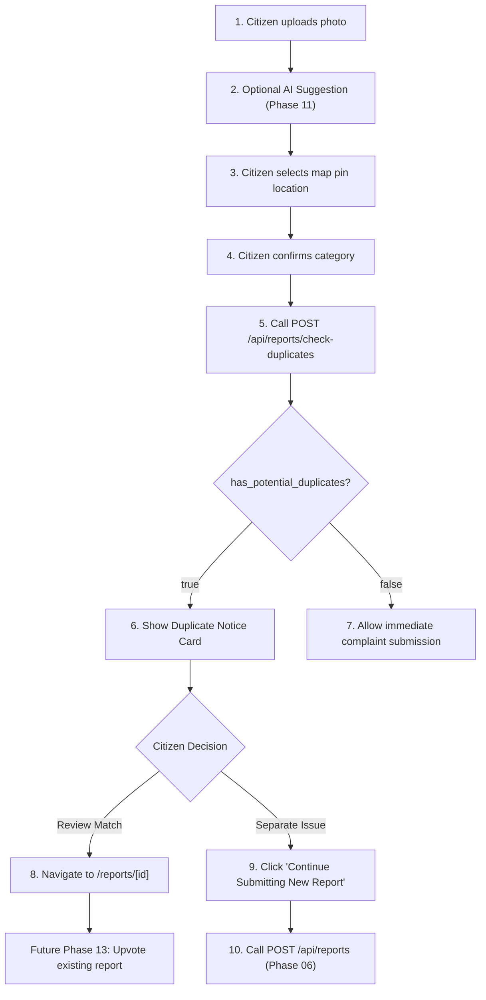

# CivicPulse – Geographical Duplicate Complaint Detection Contract

**Document Version:** 1.0.0  
**Phase:** 12 – Geographical Duplicate Complaint Detection  
**Status:** Verified Implementation  
**Audience:** Frontend Engineers, Mobile Developers, API Consumers, Quality Assurance Engineers

---

## 1. Overview & Purpose

CivicPulse duplicate detection provides **transparent, advisory nearby complaint discovery** within a server-controlled **100-meter radius**.

When a citizen selects a location on the interactive map and indicates an issue category, the frontend queries this endpoint to check if unresolved reports already exist in the immediate vicinity.

### Core Philosophy
1. **Advisory, Not Restrictive**: Geographical proximity does not guarantee identical physical problems (e.g., two potholes 25 meters apart on the same street). The system presents potential matches for citizen review; it **never** automatically prevents, rejects, merges, or deletes complaints.
2. **Citizen Sovereignty**: The citizen always retains full discretion to:
   - Review an existing nearby report.
   - Proceed with submitting their new complaint if the issue is distinct.
3. **Strict Location Privacy**: The API returns sanitized public summary records only. It never discloses the creator's identity, email, phone number, private draft image paths, or internal administrative notes.

---

## 2. API Endpoint Specification

### `POST /api/reports/check-duplicates`

- **HTTP Method:** `POST`
- **Path:** `/api/reports/check-duplicates`
- **Authentication:** **Required** (Authenticated citizen or administrator session via Supabase SSR cookies).
- **Operation:** Read-only search (does not create, update, or mutate any database records).
- **Cache Policy:** `Cache-Control: no-store`

---

## 3. Request Contract

### Headers
```http
Content-Type: application/json
```

### JSON Body Schema

| Field | Type | Required | Constraints | Description |
|---|---|---|---|---|
| `latitude` | `number` | **Yes** | Finite number, range `[-90.0, 90.0]` | Geographic latitude of proposed issue |
| `longitude` | `number` | **Yes** | Finite number, range `[-180.0, 180.0]` | Geographic longitude of proposed issue |
| `category` | `string` | **Yes** | Canonical CivicPulse enum | Category of civic infrastructure problem |
| `title_hint` | `string` | No | Optional string, max 120 chars, trimmed | Contextual title text hint (untrusted) |
| `description_hint` | `string` | No | Optional string, max 1000 chars, trimmed | Contextual description hint (untrusted) |

> [!CAUTION]
> The schema is strict (`zod.strict()`). Supplying client-injected parameters such as `radius_meters`, `role`, `status`, `user_id`, or `priority_score` will cause the request to be immediately rejected with HTTP `422 Unprocessable Entity`.

### Canonical Categories (`REPORT_CATEGORIES`)
- `"pothole"`
- `"garbage"`
- `"water_leakage"`
- `"streetlight"`
- `"drainage"`
- `"damaged_infrastructure"`
- `"other"`

### Example Request
```json
{
  "latitude": 22.5726,
  "longitude": 88.3639,
  "category": "pothole",
  "title_hint": "Large crater near college main gate"
}
```

---

## 4. Matching Policy & Rules

1. **Search Radius**: Fixed at **100 meters** (`DUPLICATE_RADIUS_METERS = 100`).
   - Calculated using the spherical **Haversine formula** with mean Earth radius `6,371,000 meters`.
   - Threshold evaluation is performed on the **unrounded distance** (`distance <= 100.0`). A candidate at `100.2m` is excluded even though display formatting would round it to `100m`.
2. **Category Matching**:
   - Matches must match the identical canonical category.
   - If `category === "other"`, the service returns `match_policy: "other_category_proximity_advisory"` to signal that 'other' is broad and proximity alone does not imply problem correlation.
   - For all other categories, the policy is `"same_category_within_100m"`.
3. **Eligible Complaint Statuses**:
   - `pending` (Awaiting administrative review)
   - `in_progress` (Assigned / under active municipal remediation)
   - `resolved` reports are **strictly excluded** because a previously repaired issue at the same location may have recurred, requiring a fresh complaint.
4. **Visibility & Privacy Filter**:
   - Public listed reports (`publication = 'public' AND visibility = 'listed'`).
   - Private complaints created by the **calling citizen** are included so they do not unknowingly submit duplicate personal reports.
   - Private complaints belonging to **other citizens** are strictly excluded.
5. **Deterministic Candidate Ranking**:
   - **Primary:** Shortest distance first (`distance_meters ASC`).
   - **Secondary (Tie-breaker):** Most recently created report (`created_at DESC`).
   - **Tertiary (Tie-breaker):** Stable alphabetical report ID (`id ASC`).
6. **Result Cap**: Top **5** nearest candidates maximum (`MAX_MATCHES = 5`).

---

## 5. Response Contract

### A. Potential Duplicates Found (HTTP 200 OK)
```json
{
  "success": true,
  "data": {
    "has_potential_duplicates": true,
    "radius_meters": 100,
    "match_policy": "same_category_within_100m",
    "matches": [
      {
        "id": "a1b2c3d4-e5f6-47a8-b9c0-123456789abc",
        "title": "Deep pothole causing bike accidents",
        "category": "pothole",
        "status": "pending",
        "distance_meters": 34,
        "created_at": "2026-11-20T10:15:30.000Z"
      },
      {
        "id": "f5e4d3c2-b1a0-4987-a654-987654321def",
        "title": "Damaged asphalt on roadway",
        "category": "pothole",
        "status": "in_progress",
        "distance_meters": 82,
        "created_at": "2026-11-19T08:30:00.000Z"
      }
    ]
  },
  "message": "Potential nearby complaints found"
}
```

### B. No Potential Duplicates Found (HTTP 200 OK)
```json
{
  "success": true,
  "data": {
    "has_potential_duplicates": false,
    "radius_meters": 100,
    "match_policy": "same_category_within_100m",
    "matches": []
  },
  "message": "No potential nearby duplicates found"
}
```

---

## 6. Error Handling

All errors adhere to the standardized CivicPulse error envelope:

| HTTP Status | Error Code | Description / Scenario |
|---|---|---|
| `400 Bad Request` | `VALIDATION_ERROR` | Request body is not valid JSON. |
| `401 Unauthorized` | `UNAUTHORIZED` | Citizen session is missing or expired. |
| `422 Unprocessable Entity` | `VALIDATION_ERROR` | Coordinates out of range (e.g. lat > 90), invalid category, or unexpected fields. |
| `500 Internal Server Error` | `INTERNAL_SERVER_ERROR` | Database query execution error. |

### Example Error Response
```json
{
  "success": false,
  "error": {
    "code": "VALIDATION_ERROR",
    "message": "Latitude must be between -90 and 90 degrees"
  }
}
```

---

## 7. Frontend Integration Workflow



### Recommended UI Notice Copy
- **Headline:** *"Similar complaints were reported nearby"*
- **Advisory text:** *"We found 2 active complaints within 100 meters matching this category. Review an existing report before creating a new one."*
- **Actions:**
  - **Button 1 (Primary):** `View Existing Report` (`/reports/${match.id}`)
  - **Button 2 (Secondary):** `Continue Reporting New Issue` (Proceeds with normal Phase 06 submission)

---

## 8. TypeScript Hook Implementation (React Query / SWR)

```typescript
import { useState } from "react";
import type { CheckDuplicatesInput, CheckDuplicatesResponseData } from "@/types/duplicate";

export function useDuplicateCheck() {
  const [loading, setLoading] = useState(false);
  const [data, setData] = useState<CheckDuplicatesResponseData | null>(null);
  const [error, setError] = useState<string | null>(null);

  async function checkDuplicates(input: CheckDuplicatesInput) {
    setLoading(true);
    setError(null);
    try {
      const res = await fetch("/api/reports/check-duplicates", {
        method: "POST",
        headers: { "Content-Type": "application/json" },
        body: JSON.stringify(input),
      });

      const json = await res.json();
      if (!res.ok || !json.success) {
        throw new Error(json?.error?.message || "Failed to check nearby complaints");
      }

      setData(json.data);
      return json.data;
    } catch (err: any) {
      setError(err.message || "Network error");
      // Advisory non-blocking behavior: do not block reporting if duplicate check fails
      return null;
    } finally {
      setLoading(false);
    }
  }

  return { checkDuplicates, data, loading, error };
}
```

---

## 9. Compatibility with Phase 13 (Future Community Upvotes)

In **Phase 13**, CivicPulse will introduce citizen upvoting for existing complaints (`POST /api/reports/:id/upvote`).
- The `id` returned in `matches[i].id` is the permanent, canonical UUID of the existing database complaint.
- In Phase 13, the frontend will be able to display:
  `"Support this existing complaint (+1 Upvote)"` passing `match.id` directly into the Phase 13 voting API.
- In Phase 12, **no voting actions are performed** and **no upvote tables are modified**.
