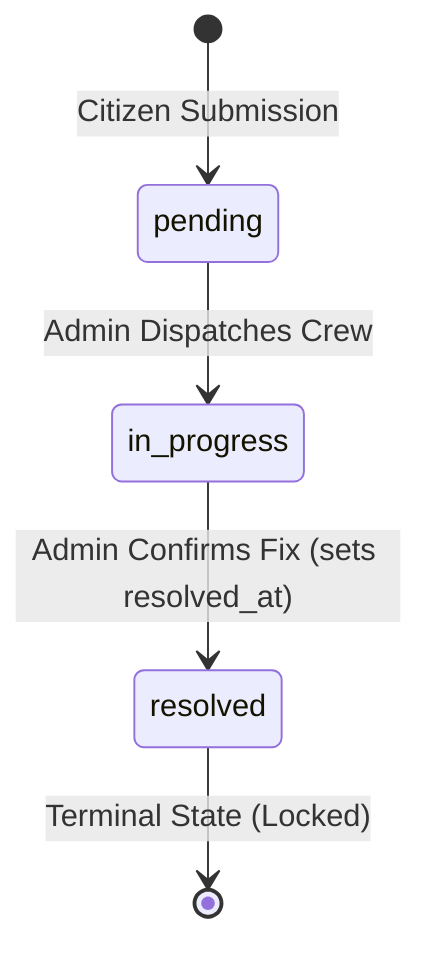

# CivicPulse: Frontend-Backend Handoff & Developer Guide (Phase 10)

> **Document Version**: 1.0.0  
> **Status**: Verified & Ready for Frontend Integration  
> **Target Audience**: Frontend Engineers, Full-Stack Developers, Integration Testers  
> **Backend Branch**: `backend`  

---

## 1. Executive Summary & Overview

This document provides complete, production-ready integration contracts, schemas, TypeScript interfaces, and copy-paste examples for connecting the CivicPulse Next.js frontend to the fully verified backend (Phases 01–10).

The CivicPulse backend is built on Next.js App Router Route Handlers, Supabase PostgreSQL with strict Row Level Security (RLS), Supabase Auth with secure HTTP-only cookie sessions via `@supabase/ssr`, and private Supabase Storage (`civic-evidence`).

All responses strictly follow the standard JSON envelope:
- **Success**: `{ "data": T, "error": null }`
- **Failure**: `{ "data": null, "error": { "code": string, "message": string, "details"?: unknown } }`

---

## 2. Authentication & Session Management

Authentication relies on standard HTTP-only, secure, SameSite cookies handled seamlessly by `@supabase/ssr`. Frontend requests do **not** need to manually attach Bearer tokens; the browser automatically carries session cookies on all `fetch` or Axios requests with `credentials: "include"`.

### Endpoints

| Method | Endpoint | Description | Auth Required |
| :--- | :--- | :--- | :--- |
| `POST` | `/api/auth/register` | Register a new citizen | No |
| `POST` | `/api/auth/login` | Login with email and password | No |
| `POST` | `/api/auth/logout` | Terminate session and clear cookies | Yes |
| `GET` | `/api/auth/me` | Retrieve authenticated user profile & role | Yes |
| `GET` | `/auth/confirm` | Email confirmation / magic link callback | No |

### Client Session State Hook Example

```typescript
import { useQuery } from "@tanstack/react-query";

export interface UserProfile {
  id: string;
  email: string;
  full_name: string;
  role: "citizen" | "admin";
}

export function useCurrentUser() {
  return useQuery<UserProfile | null>({
    queryKey: ["currentUser"],
    queryFn: async () => {
      const res = await fetch("/api/auth/me", { credentials: "include" });
      if (res.status === 401) return null;
      if (!res.ok) throw new Error("Failed to fetch session");
      const json = await res.json();
      return json.data;
    },
    staleTime: 5 * 60 * 1000, // 5 minutes
    retry: false,
  });
}
```

---

## 3. Evidence Image Upload Lifecycle

All civic complaint images are stored privately in Supabase Storage. Direct public URLs are prohibited.

### Two-Step Upload Sequence

1. **Step 1: Staging Upload** (`POST /api/upload`)
   - Send `multipart/form-data` containing the field `file`.
   - Backend validates MIME type, magic bytes, file size (max 5MB), and dimensions.
   - Backend saves to `drafts/<user_id>/<image_uuid>.<ext>` and returns the draft storage path.
2. **Step 2: Complaint Submission** (`POST /api/reports`)
   - Pass the returned `image_path` in the JSON request body.
   - The backend validates that the draft path matches the authenticated caller's UUID, moves/links it atomically to the report, and locks it against reuse.

### Frontend Upload Hook Example

```typescript
export async function uploadEvidenceFile(file: File): Promise<string> {
  const formData = new FormData();
  formData.append("file", file);

  const res = await fetch("/api/upload", {
    method: "POST",
    body: formData,
    credentials: "include",
  });

  const json = await res.json();
  if (!res.ok || json.error) {
    throw new Error(json.error?.message || "File upload failed");
  }

  // Returns "drafts/<user_id>/<uuid>.<ext>"
  return json.data.image_path;
}
```

---

## 4. Citizen Complaint Creation API

- **Endpoint**: `POST /api/reports`
- **Authorization**: Authenticated Citizen or Admin
- **Content-Type**: `application/json`

### Request Body Schema

```typescript
export interface CreateReportPayload {
  title: string;        // 5 - 120 chars, sanitized
  description: string;  // 10 - 2000 chars
  category: "pothole" | "garbage" | "street_light" | "water_leakage" | "drainage" | "other";
  latitude: number;     // -90 to 90
  longitude: number;    // -180 to 180
  image_path: string;   // Must start with "drafts/<user_id>/"
}
```

> **Note**: Server sets default `status: "pending"`, `priority_score: 0`, and `department_id: null`. Injected client fields are strictly rejected with HTTP 422.

### Success Response (`201 Created`)

```json
{
  "data": {
    "id": "44444444-4444-4444-8444-444444444444",
    "reference": "POTH-202611-0001",
    "status": "pending",
    "priority_score": 0,
    "created_at": "2026-11-21T18:00:00.000Z",
    "updated_at": "2026-11-21T18:00:00.000Z"
  },
  "error": null
}
```

---

## 4.1 Geographical Duplicate Complaint Detection

- **Endpoint**: `POST /api/reports/check-duplicates`
- **Authorization**: Authenticated Citizen or Admin
- **Content-Type**: `application/json`
- **Purpose**: Checks for potential active duplicate complaints within a server-enforced 100-meter radius using the spherical Haversine formula.

### Request Body Schema
```json
{
  "latitude": 22.5726,
  "longitude": 88.3639,
  "category": "pothole",
  "title_hint": "Optional title hint"
}
```

### Response Example (HTTP 200)
```json
{
  "success": true,
  "data": {
    "has_potential_duplicates": true,
    "radius_meters": 100,
    "match_policy": "same_category_within_100m",
    "matches": [
      {
        "id": "a1b2c3d4-e5f6-47a8-b9c0-123456789abc",
        "title": "Deep pothole near entrance",
        "category": "pothole",
        "status": "pending",
        "distance_meters": 34,
        "created_at": "2026-11-20T10:15:30.000Z"
      }
    ]
  },
  "message": "Potential nearby complaints found"
}
```

### UI Advisory Behavior
- If `has_potential_duplicates === true`: Present an advisory banner or card.
- Allow the citizen to view the existing complaint (`/reports/${match.id}`) or continue submitting their new report.
- Allow the citizen to express community support (upvote) on the existing duplicate complaint directly from the advisory card.
- Never automatically block complaint submission based solely on duplicate proximity.

---

## 4.2 Community Support & Secure Upvoting

Citizens can express community support for existing visible complaints. Community support indicates civic urgency, reinforces duplicate detection, and will feed Phase 14 priority scoring without allowing vote manipulation.

### Endpoints

| Method | Endpoint | Auth | Purpose |
| :--- | :--- | :--- | :--- |
| `POST` | `/api/reports/:id/upvote` | Citizen Session | Express community support for complaint |
| `GET` | `/api/reports/:id/support` | Public / Optional Auth | Retrieve support count & contextual flags |

### Business Rules & Security Constraints
1. **One-User-One-Vote**: Enforced at the database level via `UNIQUE(report_id, user_id)`.
2. **Self-Voting Forbidden**: Report creators cannot upvote their own complaints (HTTP 403 `FORBIDDEN`).
3. **Admin Excluded**: Administrative accounts cannot cast citizen community votes (HTTP 403 `FORBIDDEN`).
4. **Active Complaints Only**: Votes are accepted only on `pending` or `in_progress` complaints. `resolved` complaints return HTTP 409 `CONFLICT`.
5. **Idempotent Handling**: Repeated clicks by the same user return HTTP 200 (`already_supported: true`) without throwing errors or inflating vote totals.
6. **Voter Privacy**: Individual voter identities (UUIDs, names, emails) are strictly omitted from responses.

### Request / Response Schemas

#### Upvote Action (`POST /api/reports/:id/upvote`)
```typescript
// Request: Empty JSON body or omitted body. Injected fields (user_id, vote_count, etc.) return HTTP 422.
// Response (HTTP 201 for first vote, HTTP 200 for repeat vote):
export interface SupportReportResponseData {
  report_id: string;
  supported: boolean;
  already_supported: boolean;
  support_count: number;
}
```

#### Support Summary (`GET /api/reports/:id/support`)
```typescript
// Response (HTTP 200):
export interface ReportSupportSummary {
  report_id: string;
  support_count: number;
  current_user_supported: boolean;
  can_support: boolean;
}
```

### Frontend Support Button Hook Example

```typescript
import { useMutation, useQuery, useQueryClient } from "@tanstack/react-query";
import type { SupportReportResponseData, ReportSupportSummary } from "@/types/support";

export function useReportSupport(reportId: string) {
  const queryClient = useQueryClient();

  const summaryQuery = useQuery<ReportSupportSummary>({
    queryKey: ["reportSupport", reportId],
    queryFn: async () => {
      const res = await fetch(`/api/reports/${reportId}/support`, { credentials: "include" });
      if (!res.ok) throw new Error("Failed to fetch support summary");
      const json = await res.json();
      return json.data;
    },
  });

  const upvoteMutation = useMutation<SupportReportResponseData, Error>({
    mutationFn: async () => {
      const res = await fetch(`/api/reports/${reportId}/upvote`, {
        method: "POST",
        headers: { "Content-Type": "application/json" },
        body: JSON.stringify({}),
        credentials: "include",
      });
      const json = await res.json();
      if (!res.ok || json.error) {
        throw new Error(json.error?.message || "Failed to support complaint");
      }
      return json.data;
    },
    onMutate: async () => {
      // Cancel outgoing queries for optimistic update
      await queryClient.cancelQueries({ queryKey: ["reportSupport", reportId] });
      const previous = queryClient.getQueryData<ReportSupportSummary>(["reportSupport", reportId]);

      if (previous && !previous.current_user_supported) {
        queryClient.setQueryData<ReportSupportSummary>(["reportSupport", reportId], {
          ...previous,
          support_count: previous.support_count + 1,
          current_user_supported: true,
          can_support: false,
        });
      }
      return { previous };
    },
    onError: (_err, _vars, context) => {
      if (context?.previous) {
        queryClient.setQueryData(["reportSupport", reportId], context.previous);
      }
    },
    onSettled: () => {
      queryClient.invalidateQueries({ queryKey: ["reportSupport", reportId] });
      queryClient.invalidateQueries({ queryKey: ["report", reportId] });
      queryClient.invalidateQueries({ queryKey: ["reports"] });
    },
  });

  return {
    summary: summaryQuery.data,
    isLoading: summaryQuery.isLoading,
    upvote: upvoteMutation.mutate,
    isUpvoting: upvoteMutation.isPending,
  };
}
```

---

## 4.3 Intelligent Priority Scoring Engine & Breakdown

Civic complaints receive an explainable, deterministic 0–100 priority score calculated via:
```
priority_score = min(
  100,
  severityPoints + min(3 * voteCount, 20) + min(2 * daysPending, 10)
)
```

### Endpoints

| Method | Endpoint | Auth | Purpose |
| :--- | :--- | :--- | :--- |
| `GET` | `/api/reports/:id/priority` | Public / Contextual | Retrieve transparent score breakdown |
| `GET` | `/api/reports?sort=priority_high` | Public / Authenticated | Retrieve complaints sorted highest priority first |

### Score Component Weights

- **Severity Points**: `low: 15`, `medium: 30`, `high: 50`, `critical: 70`.
- **Support Points**: 3 points per valid distinct vote, capped at 20 points.
- **Age Points**: 2 points per completed 24-hour period unresolved, capped at 10 points. Stops accumulating upon resolution.
- **Total Cap**: 100 points maximum.

### Frontend Priority Breakdown Hook Example

```typescript
import { useQuery } from "@tanstack/react-query";
import type { ReportPriorityData } from "@/types/priority";

export function useReportPriority(reportId: string) {
  return useQuery<ReportPriorityData>({
    queryKey: ["reportPriority", reportId],
    queryFn: async () => {
      const res = await fetch(`/api/reports/${reportId}/priority`, { credentials: "include" });
      if (!res.ok) throw new Error("Failed to fetch priority breakdown");
      const json = await res.json();
      return json.data;
    },
    staleTime: 60 * 1000,
  });
}
```

---

## 5. Complaint Retrieval APIs

### 5.1 Public Feed Listing

- **Endpoint**: `GET /api/reports`
- **Auth**: Public / Optional
- **Query Parameters**:
  - `page`: number (default: `1`)
  - `limit`: number (default: `10`, max: `50`)
  - `category`: optional category filter
  - `status`: optional status filter (`pending` | `in_progress` | `resolved`)
  - `severity`: optional severity filter (`low` | `medium` | `high` | `critical`)
  - `search`: optional search string (sanitized for PostgREST)

### 5.2 Personal Complaint History

- **Endpoint**: `GET /api/reports?mine=true`
- **Auth**: Authenticated User (HTTP 401 if unauthenticated)
- **Behavior**: Returns all reports created by the caller (including private/unlisted), with owner-specific projection.

### 5.3 Complaint Details by ID

- **Endpoint**: `GET /api/reports/:id`
- **Auth**: Public for public complaints; Owner/Admin only for private complaints.
- **Behavior**: Generates fresh signed storage URLs for attached evidence images. Conceals private reports with HTTP 404 to avoid leaking existence.

```json
{
  "data": {
    "id": "44444444-4444-4444-8444-444444444444",
    "reference": "POTH-202611-0001",
    "title": "Large hazardous pothole on Main Street",
    "description": "Deep pothole damaging vehicles near 4th avenue intersection.",
    "category": "pothole",
    "severity": "medium",
    "status": "pending",
    "priority_score": 0,
    "latitude": 37.7749,
    "longitude": -122.4194,
    "publication": "published",
    "visibility": "public",
    "resolved_at": null,
    "created_at": "2026-11-21T18:00:00.000Z",
    "updated_at": "2026-11-21T18:30:00.000Z",
    "department": {
      "id": "55555555-5555-5555-8555-555555555555",
      "name": "Road Maintenance",
      "description": "Road surfaces and asphalt repair"
    },
    "images": [
      {
        "id": "img-uuid-1",
        "storage_path": "drafts/...",
        "type": "before",
        "signed_url": "https://...supabase.co/storage/v1/object/sign/civic-evidence/...?token=...",
        "created_at": "2026-11-21T18:00:00.000Z"
      }
    ]
  },
  "error": null
}
```

### 5.4 Interactive Map Viewport Markers

- **Endpoint**: `GET /api/reports/map`
- **Auth**: Public / Contextual (Optional Auth; non-admins only see public/listed complaints)
- **Cache-Control**: `no-store, max-age=0`
- **Query Parameters**:
  - `south`: number (required, `-90 <= south <= 90`)
  - `west`: number (required, `-180 <= west <= 180`)
  - `north`: number (required, `-90 <= north <= 90`, `north > south`)
  - `east`: number (required, `-180 <= east <= 180`, `east !== west`)
  - `category`: optional category filter (`pothole`, `garbage`, `water_leakage`, `streetlight`, `drainage`, `damaged_infrastructure`, `other`)
  - `status`: optional status filter (`pending`, `in_progress`, `resolved`). *Defaults to active issues: `['pending', 'in_progress']` when omitted.*
  - `severity`: optional severity filter (`low`, `medium`, `high`, `critical`)
  - `department_id`: optional department UUID filter
  - `limit`: number (`1` to `300`, default: `200`)
  - `sort`: optional sort order (`created_desc` [default], `created_asc`, `priority_desc`)

#### Bounding Box Rules:
- Supports normal viewports (`west < east`) as well as International Date Line / Antimeridian crossing (`west > east`).
- Maximum viewport span guards: `latSpan <= 50.0°`, `lonSpan <= 60.0°`. (Zoom out beyond this triggers HTTP 422 `VALIDATION_ERROR`).
- Rejects zero-height (`south >= north`) and zero-width (`west === east`) viewports with HTTP 422.

#### Leaflet Viewport Bounds Helper:
```typescript
import type { MapViewport } from "@/types/map";
import type { LatLngBounds } from "leaflet";

export function toMapViewport(bounds: LatLngBounds): MapViewport {
  return {
    south: bounds.getSouth(),
    west: bounds.getWest(),
    north: bounds.getNorth(),
    east: bounds.getEast(),
  };
}
```

#### Frontend React Hook Example:
```typescript
import { useQuery } from "@tanstack/react-query";
import type { MapViewport, MapQueryFilter, MapResponseData } from "@/types/map";

export function useMapMarkers(viewport: MapViewport | null, filters?: MapQueryFilter) {
  return useQuery<MapResponseData>({
    queryKey: ["mapMarkers", viewport, filters],
    queryFn: async () => {
      if (!viewport) {
        return {
          markers: [],
          total_count: 0,
          has_more: false,
          viewport: { south: 0, west: 0, north: 0, east: 0 },
          limit: 200,
        };
      }
      const params = new URLSearchParams({
        south: viewport.south.toString(),
        west: viewport.west.toString(),
        north: viewport.north.toString(),
        east: viewport.east.toString(),
      });
      if (filters?.category) params.set("category", filters.category);
      if (filters?.status) params.set("status", filters.status);
      if (filters?.severity) params.set("severity", filters.severity);
      if (filters?.department_id) params.set("department_id", filters.department_id);
      if (filters?.limit) params.set("limit", filters.limit.toString());
      if (filters?.sort) params.set("sort", filters.sort);

      const res = await fetch(`/api/reports/map?${params.toString()}`, { credentials: "include" });
      if (!res.ok) {
        const errJson = await res.json().catch(() => ({}));
        throw new Error(errJson.error?.message || "Failed to load map markers");
      }
      const json = await res.json();
      return json.data;
    },
    enabled: Boolean(viewport),
    staleTime: 30 * 1000,
  });
}
```

#### Map Marker Data Model & Privacy Projection:
```typescript
export interface MapMarker {
  id: string;             // UUID
  reference: string;      // e.g. "POTH-202611-0001"
  title: string;
  category: ReportCategory;
  severity: ReportSeverity;
  status: ReportStatus;
  priority_score: number;
  latitude: number;
  longitude: number;
  created_at: string;     // ISO 8601
  department: {
    id: string;
    name: string;
  } | null;
}
```
*Notice: User UUIDs, citizen email, voter records, detailed description, internal admin notes, and private storage paths are strictly stripped server-side.*

---

## 6. Department Management & Assignment (Admin Only)

### 6.1 Department Directory

- **Endpoint**: `GET /api/departments`
- **Auth**: Public / Authenticated
- **Returns**: Directory of all active city departments, deterministically sorted alphabetically by `name ASC`.

### 6.2 Manual Complaint Assignment

- **Endpoint**: `POST /api/admin/assign`
- **Auth**: Administrator only (HTTP 403 for citizens)
- **Request Body**:
  ```typescript
  export interface AssignDepartmentPayload {
    report_id: string;              // UUID
    department_id: string;          // UUID
    expected_department_id?: string;// Optional UUID for optimistic concurrency
    notes?: string;                 // Optional note (max 500 chars)
  }
  ```
- **Manual Override Precedence**: Sets `manual_override = true` and `assignment_source = "manual"`. This permanently locks the complaint from being overwritten by automatic routing.

### 6.3 Automatic Department Routing & Admin Retry

- **Automatic Assignment at Creation**: Newly submitted complaints with canonical categories (`pothole`, `garbage`, `water_leakage`, `streetlight`, `drainage`, `damaged_infrastructure`) are automatically assigned to their respective departments (`Road Maintenance`, `Sanitation`, `Water Supply`, `Electrical`, `Drainage`, `Public Works`) with `assignment_source: "automatic"`.
- **Manual Review Category**: Complaints with category `other` remain unassigned (`department_id: null`, `assignment_source: "unassigned"`) for administrative review.
- **Admin Routing Retry Endpoint**: `POST /api/admin/route`
- **Auth**: Administrator only (HTTP 403 for citizens)
- **Request Body**:
  ```typescript
  export interface AdminRouteReportPayload {
    report_id: string;              // UUID
    expected_department_id?: string | null; // Optional optimistic concurrency check
  }
  ```
- **Response**: Returns standardized `RoutingResult` (`routing_status`, `assignment_source`, `department`, `rule_key`). Respects manual override precedence.

---

## 7. Status Workflow & Citizen Tracking

### 7.1 Linear State Machine



### 7.2 Update Status Endpoint

- **Endpoint**: `PATCH /api/reports/:id/status`
- **Auth**: Administrator only
- **Request Body**:
  ```typescript
  export interface UpdateStatusPayload {
    status: "in_progress" | "resolved";
    expected_status?: "pending" | "in_progress"; // Optimistic concurrency check
    notes?: string;                             // Internal note (max 1000 chars)
    after_image_path?: string;                  // Mandatory when status === "resolved"
  }
  ```
- **Phase 17 Mandatory Evidence Rule**: Transitioning to `resolved` requires `after_image_path` uploaded via `POST /api/admin/reports/:id/resolution-evidence`. Without it, returns HTTP 422 `VALIDATION_ERROR`.

### 7.3 Status History & Milestone Timeline

- **Endpoint**: `GET /api/reports/:id/history`
- **Auth**: Public for public reports; Owner/Admin for private reports.
- **Privacy Enforcement**:
  - **Citizens / Public**: Receive status transition milestones (`previous_status`, `new_status`, `created_at`). `notes` and `changed_by` are sanitized to `null`.
  - **Administrators**: Receive full audit logging including `notes` and administrative `changed_by` actor UUID.

### 7.4 Administrator Resolution Evidence & Before/After Comparison

- **Upload Resolution Evidence**: `POST /api/admin/reports/:id/resolution-evidence`
  - Accepts `multipart/form-data` with field `file` (JPEG, PNG, WebP; max 3 MB).
  - Report must be in `in_progress` status.
  - Returns `storage_path` in `resolution-drafts/<admin_id>/<report_id>/<uuid>.<ext>`.
- **Retrieve Evidence**: `GET /api/reports/:id/evidence`
  - Returns `{ report_id, status, resolved_at, attribution_notice, before_images, after_images }` with short-lived signed URLs.
  - Attribution Notice: *"Marked resolved by an administrator with after-repair evidence."* (Do not claim independent municipal certification).

---

## 8. Standard Error Codes & Envelope Format

All API errors return standard HTTP status codes and a consistent JSON payload:

```json
{
  "data": null,
  "error": {
    "code": "VALIDATION_ERROR",
    "message": "Invalid request parameters",
    "details": [
      { "field": "title", "message": "Title must be at least 5 characters" }
    ]
  }
}
```

### Error Code Reference Table

| Code | HTTP Status | Description | User Message Recommendation |
| :--- | :--- | :--- | :--- |
| `VALIDATION_ERROR` | `422` | Request body or query parameters failed Zod validation | "Please check your inputs and try again." |
| `UNAUTHORIZED` | `401` | User is not logged in or session expired | "Please sign in to continue." |
| `FORBIDDEN` | `403` | User lacks required role (e.g., citizen calling admin API) | "You do not have permission to perform this action." |
| `NOT_FOUND` | `404` | Report, image, or department does not exist | "The requested item could not be found." |
| `CONFLICT` | `409` | Optimistic concurrency mismatch, duplicate image, or invalid state transition | "This record was updated by another user or is in a conflicting state. Please refresh." |
| `INTERNAL_SERVER_ERROR` | `500` | Unhandled server error | "An unexpected error occurred. Please try again shortly." |

---

## 9. Ready-to-Use Frontend API Client Examples

```typescript
// src/lib/api/reports.ts
import type { CreateReportPayload, ReportDetailItem, ReportListResponse } from "@/types/report";
import type { AIClassifyInput, AIClassificationData } from "@/types/ai";

export async function requestAISuggestions(payload: AIClassifyInput): Promise<AIClassificationData> {
  const res = await fetch("/api/ai/classify", {
    method: "POST",
    headers: { "Content-Type": "application/json" },
    body: JSON.stringify(payload),
    credentials: "include",
  });
  const json = await res.json();
  if (!res.ok || !json.success) throw new Error(json.error?.message || "Failed to analyze image");
  return json.data;
}

export async function submitReport(payload: CreateReportPayload) {
  const res = await fetch("/api/reports", {
    method: "POST",
    headers: { "Content-Type": "application/json" },
    body: JSON.stringify(payload),
    credentials: "include",
  });
  const json = await res.json();
  if (!res.ok) throw new Error(json.error?.message || "Failed to submit report");
  return json.data;
}

export async function fetchReportDetails(id: string): Promise<ReportDetailItem> {
  const res = await fetch(`/api/reports/${id}`, { credentials: "include" });
  const json = await res.json();
  if (!res.ok) throw new Error(json.error?.message || "Report not found");
  return json.data;
}

export async function assignReportDepartment(
  reportId: string,
  departmentId: string,
  expectedDepartmentId?: string
) {
  const res = await fetch("/api/admin/assign", {
    method: "POST",
    headers: { "Content-Type": "application/json" },
    body: JSON.stringify({
      report_id: reportId,
      department_id: departmentId,
      expected_department_id: expectedDepartmentId,
    }),
    credentials: "include",
  });
  const json = await res.json();
  if (!res.ok) throw new Error(json.error?.message || "Failed to assign department");
  return json.data;
}
```

---

## 10. AI Multimodal Image Classification (`POST /api/ai/classify`)

- **Purpose**: Analyzes an authenticated citizen's uploaded draft image using Google Gemini and suggests complaint title, description, category, severity, and department.
- **Contract Reference**: [AI_CLASSIFICATION_CONTRACT.md](AI_CLASSIFICATION_CONTRACT.md) and [AI_ARCHITECTURE.md](AI_ARCHITECTURE.md).
- **Prerequisite**: Image must be uploaded first via `POST /api/upload`.
- **Consent**: `consent_to_ai_processing` must explicitly be `true`.
- **Human-in-the-Loop**: Suggestions are advisory only. Prefill editable form fields for citizen review. The complaint is submitted only when the user deliberately clicks "Submit Complaint" via `POST /api/reports`.
- **Graceful Fallback**: If `POST /api/ai/classify` returns 503 or 429, display an informative toast and allow the citizen to fill the complaint fields manually.

---

## 12. Administrative Analytics Engine

- **Purpose**: Operational dashboard analytics, volume trends, category breakdown, department workload, and turnaround performance.
- **Contract Reference**: [ADMIN_ANALYTICS_CONTRACT.md](ADMIN_ANALYTICS_CONTRACT.md), [ANALYTICS_ARCHITECTURE.md](ANALYTICS_ARCHITECTURE.md), and [ANALYTICS_METRICS_DICTIONARY.md](ANALYTICS_METRICS_DICTIONARY.md).
- **Access**: Strictly restricted to users with `role: "admin"`.
- **Endpoints**:
  - `GET /api/admin/analytics/overview?start=YYYY-MM-DD&end=YYYY-MM-DD`: Overall counts, active backlog, cohort resolution rate.
  - `GET /api/admin/analytics/trends?start=YYYY-MM-DD&end=YYYY-MM-DD&granularity=day|week|month`: Continuous zero-filled time-series of created vs. resolved complaints.
  - `GET /api/admin/analytics/categories?start=YYYY-MM-DD&end=YYYY-MM-DD`: Categorical distribution with counts and percentages across all 7 canonical categories.
  - `GET /api/admin/analytics/departments`: Current active complaint workload (`pending`, `in_progress`) per municipal department plus unassigned backlog.
  - `GET /api/admin/analytics/performance?start=YYYY-MM-DD&end=YYYY-MM-DD`: Resolution throughput, sample size, arithmetic mean hours, median turnaround hours, and aging backlog (> 7 days).
  - `GET /api/admin/analytics/priorities?limit=5`: Top active complaints ranked by `priority_score DESC, created_at ASC` for operational dispatch.
- **Frontend Guidelines**:
  - Use `null` checks for `creation_cohort_resolution_rate_percent`, `average_resolution_hours`, and `median_resolution_hours` (rendered as `N/A` or `--` when sample size is zero).
  - Zero-filled trend buckets can be passed directly to charting libraries (e.g. Recharts, Chart.js) without date-gap interpolation.


- **Architecture**: Private Broadcast Channels with channel-level RLS authorization.
- **Contract Reference**: [REALTIME_CONTRACT.md](REALTIME_CONTRACT.md), [REALTIME_ARCHITECTURE.md](REALTIME_ARCHITECTURE.md), and [REALTIME_SECURITY.md](REALTIME_SECURITY.md).
- **Channel**: `report:<report_id>` (private channel; authorizes owner, admin, or public visitors if listed).
- **Events**:
  - `report_updated` with `change_type`: `"status_changed" | "department_changed" | "resolution_completed"`.
- **Payload**: Minimal `{ event, report_id, change_type, occurred_at }`. No PII, no URLs, no tokens.
- **Client Action**: Treat as invalidation signal; invalidate React Query cache to refetch authoritative data via `GET /api/reports/:id`, `GET /api/reports/:id/history`, and `GET /api/reports/:id/evidence`.
- **Offline / Reconnect**: On reconnection, automatically refetch `GET /api/reports/:id` to synchronize intermediate transitions.


