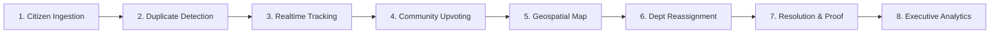

# CivicPulse – Hackathon & Live Demonstration Runbook (Phase 21)

**Document Version:** 1.0.0  
**Target Audience:** Hackathon Presenters, Judges, Evaluators, QA Engineers  
**Demo Scope:** Full Citizen-to-Admin Civic Infrastructure Resolution Journey  
**Estimated Demo Time:** 5 to 7 Minutes  

---

## 1. Demonstration Environment & Prerequisites

### 1.1 Target Architecture
- **Web Application Runtime:** Next.js 16.1.6 (App Router) on `http://localhost:3000` or Vercel Preview URL.
- **Database & Auth:** Supabase Cloud PostgreSQL with active Row Level Security (RLS).
- **Storage:** Supabase Storage private bucket `civic-evidence`.

### 1.2 Setup Prerequisites
Ensure the environment is validated prior to starting the demo:
```bash
# 1. Verify runtime environment configuration
npm run check:env

# 2. Verify all backend unit and integration suites pass
npm test

# 3. Start local development server (or use hosted Vercel deployment)
npm run dev
```

### 1.3 Safe Synthetic Test Personas (Do Not Store Real Credentials)
*For security compliance, all accounts use isolated synthetic test personas. Passwords are supplied securely during onboarding.*

| Persona Role | Synthetic Email Identifier | Granted Capabilities | Demo Scope |
|---|---|---|---|
| **Citizen Reporter** | `citizen.jane@example.com` | Create reports, upvote community issues | Ingestion, Geolocation, Upvoting |
| **Community Member** | `citizen.bob@example.com` | Upvote existing reports, view public map | Duplicate checks, Community priority |
| **Department Staff** | `staff.transport@example.com` | Manage assigned reports, upload resolution proof | Status transitions, Evidence capture |
| **Super Administrator** | `admin.civic@example.com` | Department reassignments, Executive analytics | Routing override, System KPIs |

---

## 2. Recommended Live Feature Order (5–7 Minute Script)



### Step 1: Citizen Complaint Ingestion (`/reports/new`)
- **Action:** Sign in as `citizen.jane@example.com`. Fill out complaint form:
  - **Category:** `Pothole / Road Damage`
  - **Title:** `Severe pothole near 5th and Main`
  - **Description:** `Large pothole obstructing right lane, causing traffic hazards.`
  - **Location:** Latitude `37.7749`, Longitude `-122.4194` (Civic Center area).
  - **Upload Image:** Select a sample damaged road photo.
- **Expected API Call:** `POST /api/reports` -> Returns `201 Created` with `report_id`, calculated `priority_score: 45`, and auto-assigned `department_id` (Public Works).
- **Visual Highlight:** AI classification auto-populates category and extracts severity tag.

### Step 2: Proactive Duplicate Detection (`/reports/new`)
- **Action:** Open an incognito tab, sign in as `citizen.bob@example.com`, and attempt to create a report within 100 meters (e.g., Lat `37.7751`, Lng `-122.4192`) with category `road`.
- **Expected API Call:** `POST /api/reports/check-duplicate` -> Returns `200 OK` with `has_duplicate: true` and the existing report details.
- **Presenter Script:** *"Notice how CivicPulse detects nearby matching complaints in real time, encouraging the citizen to upvote the existing report rather than cluttering municipal dispatch with duplicate tickets."*

### Step 3: Community Upvoting & Priority Recalculation (`/reports/[id]`)
- **Action:** Click **"Upvote This Report"** on the existing ticket.
- **Expected API Call:** `POST /api/reports/[id]/vote` -> Returns `200 OK` with updated `vote_count: 2`.
- **Database Behavior:** The PostgreSQL trigger automatically invokes `calculatePriority`, immediately boosting the complaint priority score from `45` to `52`.
- **Enforcement Highlight:** Try clicking upvote again; observe idempotent `409 Conflict` or smooth client deduplication enforcing one-user-one-vote.

### Step 4: Interactive Geospatial Map (`/map`)
- **Action:** Navigate to the public map view. Pan and zoom across the city grid.
- **Expected API Call:** `GET /api/map/markers?min_lat=...&max_lat=...` -> Returns sanitized marker array.
- **Visual Highlight:** Pins color-coded by severity (Critical = Red, Moderate = Amber, Low = Blue). Clicking a marker opens a popup displaying non-sensitive complaint info, vote count, and status badge without leaking citizen email or private data.

### Step 5: Department Worklist & Manual Admin Override (`/admin/reports`)
- **Action:** Sign in as `admin.civic@example.com`. Open the Master Dispatch Table.
- **Action:** Reassign the pothole ticket from `Public Works` to `Special Transit Ops`.
- **Expected API Call:** `PATCH /api/reports/[id]/assign` -> Returns `200 OK`.
- **Audit Verification:** View complaint audit log tab showing immutable history record: `Reassigned by Admin from Public Works to Special Transit Ops`.

### Step 6: Atomic Complaint Resolution & Evidence Upload (`/admin/reports/[id]`)
- **Action:** Sign in as `staff.transport@example.com`. Move ticket status from `in_progress` to `resolved`.
- **Action:** Upload the "After" repair photo as resolution proof.
- **Expected API Call:** `POST /api/evidence/verify` -> Uploads to private bucket `civic-evidence/resolved/`, verifies image metadata, and commits atomic status transition.
- **Visual Highlight:** Side-by-side Before/After photo comparison viewer.

### Step 7: Executive Analytics & Operations KPIs (`/admin/analytics`)
- **Action:** Open Executive Analytics Dashboard.
- **Expected API Call:** `GET /api/admin/analytics/kpi-summary` and `GET /api/admin/analytics/department-workload`.
- **Visual Highlight:** Live charts showing MTTR (Mean Time to Resolution), category distribution pie chart, and SLA compliance percentages calculated strictly server-side.

---

## 3. Safe Failure Handling & Fallbacks

| Feature | Potential Failure Mode | Built-in Fallback Mechanism | Presenter Script |
|---|---|---|---|
| **Gemini AI Vision** | API key missing, quota exceeded, or network timeout | Server defaults to deterministic keyword heuristic & citizen's manual selection | *"Our multimodal vision pipeline enhances reports automatically, but CivicPulse remains 100% operational even in offline or disconnected environments."* |
| **Realtime WebSockets** | Port 443 blocked on venue Wi-Fi or proxy timeout | Frontend auto-falls back to 10-second polling against `/api/reports/[id]` | *"Supabase Realtime provides instant push updates, with automatic resilient polling fallback."* |
| **Empty State** | Clean demo database with 0 complaints | Map and feeds display welcoming empty-state cards with "Report First Issue" button | *"In a new municipal deployment, CivicPulse provides intuitive empty-state guidance."* |

---

## 4. Resetting Demo Fixtures (Safe Teardown)

To reset demo data back to clean baseline state without altering municipal department configurations:
```sql
-- Safe synthetic cleanup query (Execute in Supabase SQL Editor if resetting demo)
DELETE FROM votes WHERE user_id IN (SELECT id FROM auth.users WHERE email LIKE '%@example.com');
DELETE FROM report_history WHERE report_id IN (SELECT id FROM reports WHERE title LIKE '%[DEMO]%');
DELETE FROM reports WHERE title LIKE '%[DEMO]%' OR user_id IN (SELECT id FROM auth.users WHERE email LIKE '%@example.com');
```
*Note: System tables (`departments`, `categories`, `audit_logs`) and production records are preserved.*
