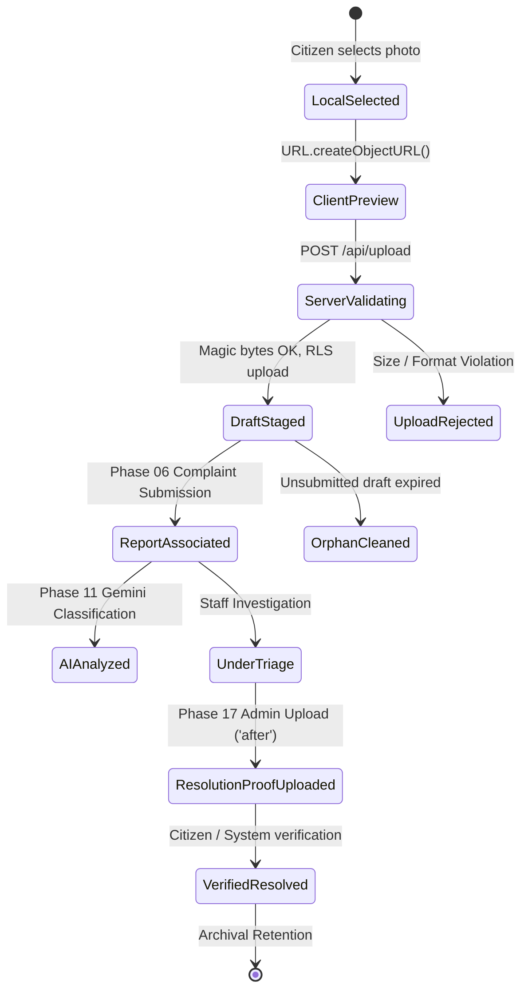
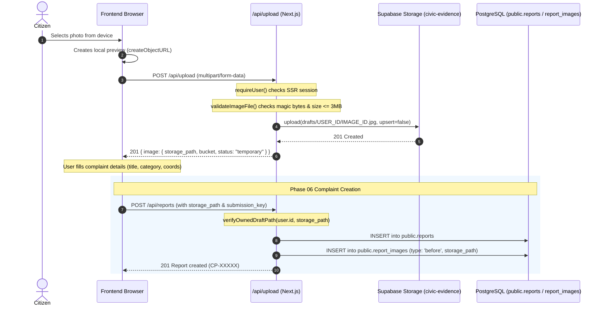

# CivicPulse Image Evidence Lifecycle · Phase 05

This document describes the complete lifecycle of photographic evidence in CivicPulse—from citizen capture to draft staging, complaint association, AI classification, administrative resolution, and retention.

---

## 1. Lifecycle State Machine

---

## 2. Sequence Diagram: Upload & Phase 06 Association

---

## 3. Phase Boundaries & Future Responsibilities

### Phase 05 (Current)
- Staging uploaded photos in `drafts/<user_id>/<image_id>.<ext>`.
- Enforcing 3 MB size limit and JPEG/PNG/WebP signatures.
- Returning an authorized storage reference to the frontend.
- Zero fake rows inserted into `public.report_images`.

### Phase 06 (Complaint Creation - Implemented)
- Receives `storage_path` in `POST /api/reports` complaint submission payload.
- Verifies storage ownership via `verifyOwnedDraftPath(user.id, storage_path)` to ensure the draft belongs to the reporter.
- Verifies uniqueness: prevents linking an already-associated image to another report (`409 CONFLICT`).
- Links the image to the new report in `public.report_images` (`type = 'before'`) within an atomic database transaction.
- Updates Storage RLS `citizen_delete_draft`: blocks citizens from deleting any storage object once it is linked in `public.report_images`.

### Phase 11 (Gemini Analysis)
- The backend retrieves the raw image bytes server-side using the verified `storage_path`.
- Extracts infrastructure issue characteristics to suggest category/severity.

### Phase 17 (Administrative Resolution)
- Authorized administrator uploads repair proof with `purpose = 'resolution_after'`.
- Uploads to `reports/<report_id>/after/<image_id>.<ext>`.
- Links to `public.report_images` with `type = 'after'`.

---

## 4. Retention & Orphan Cleanup Strategy

- **Temporary Drafts**: Files located in `drafts/*` that are not associated with a `public.report_images` record after 48 hours are considered orphaned drafts.
- **Cleanup Automation**: In production, a scheduled Supabase cron job or Edge Function compares `storage.objects` paths with `public.report_images.storage_path` and deletes unreferenced drafts older than 48 hours.
- **Evidence Immutability**: Once an image is referenced in `public.report_images`, the database foreign key constraint (`ON DELETE RESTRICT`) and Storage RLS protect it from accidental or unauthorized deletion.
