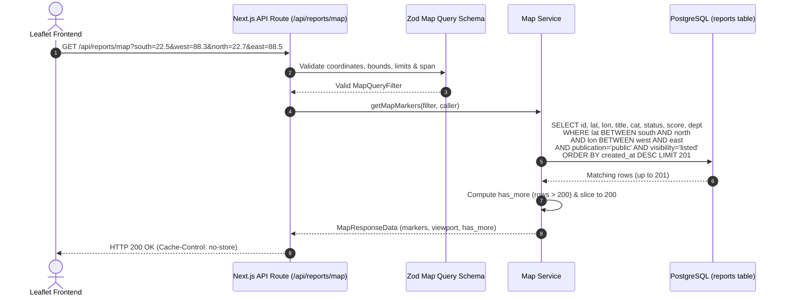

# CivicPulse Map Query Architecture (Phase 16)

## 1. Architectural Overview

The CivicPulse Map Query Architecture delivers efficient, database-side spatial retrieval for civic infrastructure complaints. It is built to serve interactive mapping clients (e.g. Leaflet) with sub-second response times while strictly adhering to application-level and database-level security policies.



---

## 2. Spatial Coordinate Storage & Units

- **Storage Columns**: `reports.latitude` (`double precision`), `reports.longitude` (`double precision`).
- **Coordinate System**: WGS 84 (EPSG:4326), decimal degrees.
  - Latitude: `[-90.000000, +90.000000]`
  - Longitude: `[-180.000000, +180.000000]`
- **No Heavy PostGIS Dependency**: Rectangular bounding-box viewport queries are computed using fast, native PostgreSQL numeric comparisons without requiring the PostGIS extension, minimizing runtime footprint.

---

## 3. Viewport Geometry & Antimeridian Support

### 3.1 Normal Bounding Box (`west <= east`)
For viewports that do not cross the 180° meridian:
$$\text{south} \le \text{latitude} \le \text{north}$$
$$\text{west} \le \text{longitude} \le \text{east}$$
In PostgreSQL:
```sql
WHERE latitude >= p_south AND latitude <= p_north
  AND longitude >= p_west AND longitude <= p_east
```

### 3.2 Antimeridian-Crossing Bounding Box (`west > east`)
When a user views regions spanning across the International Date Line (e.g. Fiji, Chukotka, New Zealand / Pacific islands):
- `west` is positive (e.g. `+170.0°`)
- `east` is negative (e.g. `-170.0°`)
- Mathematical longitude condition:
$$\text{longitude} \ge \text{west} \quad\lor\quad \text{longitude} \le \text{east}$$
In PostgreSQL / Supabase Query Builder:
```ts
query.or(`longitude.gte.${filter.west},longitude.lte.${filter.east}`)
```

### 3.3 Degenerate & Oversized Viewport Handling
- Zero-height viewports (`south >= north`) are rejected.
- Zero-width viewports (`west === east`) are rejected.
- Latitude span > 50° or Longitude span > 60° triggers an immediate `VIEWPORT_TOO_LARGE` rejection, protecting database IO against full-globe scans.

---

## 4. Query Construction & Over-Fetching Strategy

To provide an accurate `has_more` overflow indicator without executing an expensive `SELECT COUNT(*)` across thousands of rows:
1. The server requests `limit + 1` rows (e.g., 201 rows for a limit of 200).
2. If the database returns 201 rows:
   - `has_more = true`
   - The result is sliced down to 200 rows.
3. If the database returns $\le 200$ rows:
   - `has_more = false`
   - All returned rows are projected.

---

## 5. Security & Visibility Projections

| Caller Role | Applied Row Predicates | Exposed Columns |
|---|---|---|
| **Anonymous Visitor** | `publication = 'public' AND visibility = 'listed'` | `id, latitude, longitude, title, category, status, severity, priority_score, department, created_at` |
| **Citizen (Authenticated)** | `publication = 'public' AND visibility = 'listed'` | Identical public preview fields |
| **Administrator** | Operational reports (`visibility != 'hidden'`) | Identical public preview fields across all operational reports |

**Excluded Fields**: Citizen user IDs, emails, telephone numbers, full descriptions, evidence image paths, status notes, voter lists, and assignment history.

---

## 6. Index Optimization

To maintain sub-50ms execution times as complaint volume scales:
1. **Existing Indexes**:
   - `reports_category_location` on `(category, status, latitude, longitude)`.
   - `reports_status_priority` on `(status, priority_score desc, created_at, id)`.
2. **Phase 16 Spatial Partial Index**:
   ```sql
   create index if not exists reports_spatial_viewport_idx
     on public.reports (latitude, longitude, status)
     where publication = 'public' and visibility = 'listed';
   ```
   Targets the exact read query used by public and citizen map sessions, reducing index size and disk footprint.
