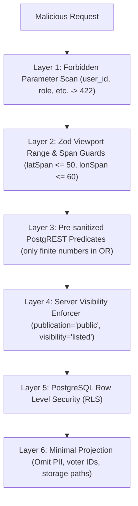

# CivicPulse Map Security & Location Privacy (Phase 16)

## 1. Threat Model & Security Posture

Geographic endpoints present unique attack vectors, including full-dataset scraping through oversized viewports, user profiling via location clustering, coordinate enumeration, and PostgREST filter injection. The CivicPulse map architecture adopts a multi-layered defensive posture:

---

## 2. Defensive Controls & Mitigation Analysis

### 2.1 Geographic Scraping & Database DoS Prevention
- **Threat**: An attacker queries `south=-90, north=90, west=-180, east=180` to dump the entire database in one call.
- **Mitigation**:
  - `mapQuerySchema` enforces `latSpan <= 50.0°` and `lonSpan <= 60.0°`.
  - Global queries are rejected before touching the database with a 422 error advising the user to zoom in.
  - Marker limits are capped server-side at `300` (default `200`). Any request with `limit > 300` or `limit <= 0` fails validation.

### 2.2 PostgREST Filter Injection in Antimeridian Predicates
- **Threat**: When compiling `.or(`longitude.gte.${west},longitude.lte.${east}`)`, an attacker attempts SQL/PostgREST injection by passing raw expressions in `west` or `east`.
- **Mitigation**:
  - `west` and `east` are pre-validated by Zod as finite numbers.
  - Non-numeric strings, empty strings, and malformed characters are rejected with HTTP 422 before the query string is constructed.

### 2.3 Citizen Identity & Voter Privacy
- **Threat**: Cross-referencing civic complaint locations with voter lists or user profiles to identify complaining citizens.
- **Mitigation**:
  - `MapMarker` projections strictly omit `user_id`, citizen `email`, `phone`, `description`, `images`, and `notes`.
  - Upvote records from Phase 13 are completely separated; voter identities are never queried or joined.
  - Private complaints (`publication = 'private'`) and hidden complaints (`visibility = 'hidden'`) are strictly filtered out for non-admin callers.

### 2.4 Caching Security
- **Threat**: An admin views an operational map with unpublished complaints; an intermediate cache serves that response to anonymous public visitors.
- **Mitigation**:
  - All responses return `Cache-Control: no-store`.
  - Shared proxy or CDN caching of map query results is strictly disallowed.

### 2.5 Defense-in-Depth RLS
- Direct database function `civicpulse_get_map_markers` is compiled as `SECURITY INVOKER`.
- Even if invoked directly over RPC, it automatically inherits and enforces the caller's active Row Level Security policies.
