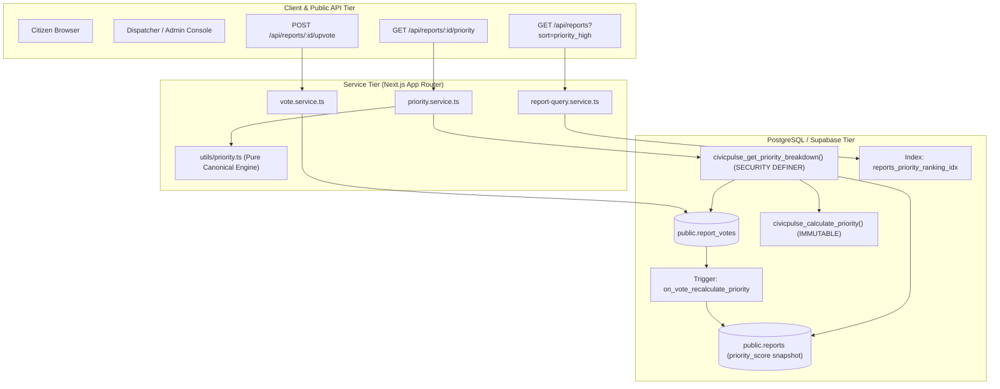

# CivicPulse Priority Scoring Engine · Technical Architecture Blueprint

> **Document Version**: 1.0.0  
> **Status**: Verified & Implemented  
> **Target Audience**: Backend Engineers, Systems Architects, Integration Leads  
> **Applicable Branch**: `backend`

---

## 1. System Architecture Diagram



---

## 2. Architecture Selection: The Hybrid Model (Option C)

CivicPulse evaluated three architectural patterns for priority scoring:
1. **Option A: Pure On-Demand Calculation**: Fresh, but makes sorting and paginating large collections in SQL difficult without repeated vote table scans.
2. **Option B: Stored Snapshot Only**: Fast for sorting, but risks age staleness if scheduled cron jobs fail or are unconfigured.
3. **Option C: Hybrid Model (Selected)**:
   - **Stored Snapshot (`reports.priority_score`)**: Maintained atomically on state mutations (report creation, valid upvote, status resolution) and indexed via `reports_priority_ranking_idx`. Powers ultra-fast, index-accelerated sorting in feed queries.
   - **Dynamic Read Calculation**: When viewing complaint details or requesting `/priority`, the score and breakdown are calculated fresh against `now()` (or `resolved_at`), guaranteeing 100% accurate age and vote reflection.
   - **Batch Operational Refresh**: An idempotent routine (`recalculateAllActiveReportPriorities`) can be triggered on a daily cadence or on-demand to refresh time-based points across all active tickets.

---

## 3. Recalculation Lifecycle & Event Flow

### Event 1: Complaint Creation (`POST /api/reports`)
- Complaint is inserted with canonical severity (`low`, `medium`, `high`, `critical`).
- Initial score is calculated as `severityPoints` (e.g. `medium` -> `30`, `high` -> `50`).
- Vote count is 0, elapsed days is 0.

### Event 2: Community Support Vote (`POST /api/reports/:id/upvote`)
- Valid distinct vote is inserted into `report_votes`.
- Database trigger `on_vote_recalculate_priority` and `vote.service.ts` atomically recalculate the new priority score and update `reports.priority_score`.
- If the vote would exceed the 20-point vote cap, the score remains capped at 20 vote points.

### Event 3: Status Transition to Resolved (`PATCH /api/reports/:id/status`)
- Complaint status moves to `resolved`, setting `resolved_at = clock_timestamp()`.
- Age accumulation stops permanently. Unresolved days are frozen as of `resolved_at`.
- The final score snapshot is preserved in `reports.priority_score`.

---

## 4. Database Indexing & Sorting Performance

To achieve sub-millisecond sorting over large datasets:

```sql
create index if not exists reports_priority_ranking_idx
on public.reports (status, priority_score desc, created_at asc, id asc);
```

### Deterministic Tie-Breaking Strategy
When multiple complaints share identical priority scores:
1. `priority_score DESC` (Urgency primary sort)
2. `created_at ASC` (Older unresolved complaints take precedence over newer ones)
3. `id ASC` (Deterministic UUID tie-breaker)

All sorting occurs **before** pagination limits and offsets (`range(offset, offset + limit - 1)`), avoiding the critical bug of sorting in JavaScript after paginating.

---

## 5. Contract Parity: TypeScript & PostgreSQL

To eliminate discrepancies between server runtime and database calculations, both engines adhere to identical mathematical rules:

```typescript
// TypeScript (src/utils/priority.ts)
const rawTotal = severityPoints + supportPoints + agePoints;
const finalScore = Math.min(100, Math.max(0, rawTotal));
```

```sql
-- PostgreSQL (supabase/migrations/20261121001100_phase14_priority_scoring.sql)
select least(100, greatest(0, v_severity_points + v_support_points + v_age_points));
```

Both engines are validated against canonical test cases A through J in automated test suites.
