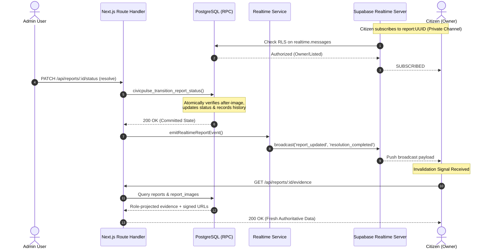
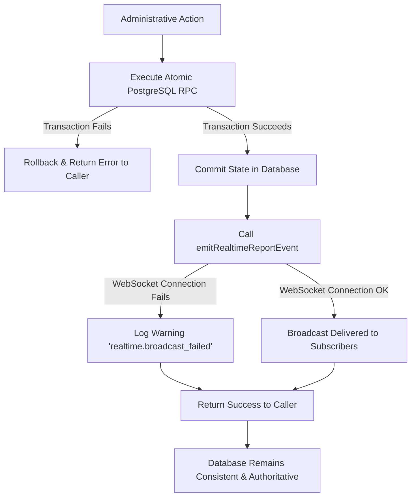

# CivicPulse: Realtime Architecture Blueprint (Phase 17)

> **Document Version**: 1.0.0  
> **Status**: Verified & Integrated  
> **Backend Branch**: `backend`  

---

## 1. High-Level Architecture Overview

CivicPulse decouples state mutations from live client notifications. PostgreSQL is the single source of authoritative truth, while Supabase Realtime delivers lightweight, non-blocking refresh signals to authorized web clients.

---

## 2. Decoupled Signaling Pattern vs. Direct Replication

| Architecture Aspect | CivicPulse Private Broadcast (Implemented) | Traditional Postgres Changes (Avoided) |
| :--- | :--- | :--- |
| **Data Leakage Risk** | **Zero**. Carries only event type and report ID. | **High**. Replicates database row columns over WebSocket. |
| **Authorization Model** | Strict channel-level RLS on `realtime.messages`. | Table-level RLS evaluated across all replication streams. |
| **Payload Size** | Minimal ($\sim 120$ bytes JSON). | Variable, potentially large with multiple columns. |
| **Database Transaction Coupling** | **Decoupled**. WebSocket failures never fail DB mutations. | Coupled to Postgres logical replication slot throughput. |
| **State Authority** | Advisory invalidation signal; triggers secure HTTP refetch. | Clients often treat WebSocket row payload as authoritative state. |

---

## 3. Resilience to Realtime Failure

If Supabase Realtime or the client's WebSocket connection is unavailable:
1. The database transaction **remains committed**.
2. The route handler returns HTTP 200 to the caller.
3. The client falls back to standard HTTP fetching on next interaction or manual refresh.
