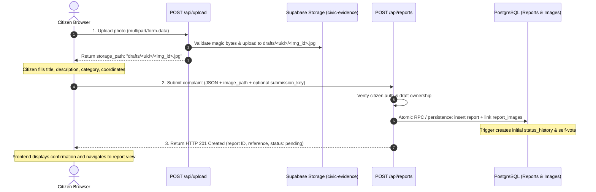

# CivicPulse Report Creation API & Integration Contract

## Overview

The `POST /api/reports` endpoint allows an authenticated citizen to submit a new civic infrastructure complaint. The complaint is validated against strict constraints, linked to an owned draft photograph previously uploaded via Phase 05 (`POST /api/upload`), and persisted atomically in Supabase PostgreSQL.

---

## Endpoint Specification

- **Endpoint**: `POST /api/reports`
- **Authentication**: Required (Cookie-based SSR session via Supabase Auth)
- **Role Requirement**: `citizen` (Administrative accounts are prohibited from submitting citizen complaints)
- **Content-Type**: `application/json`
- **Cache-Control**: `no-store` (applied to both success and error responses)

---

## Request Schema

### Headers

| Header | Value | Description |
|---|---|---|
| `Content-Type` | `application/json` | Required |
| `Cookie` | `sb-*-auth-token=...` | Managed automatically by browser / `@supabase/ssr` |

### JSON Payload

```json
{
  "title": "Large pothole on Park Street",
  "description": "A deep crater is causing severe vehicular disruption near the college entrance.",
  "category": "pothole",
  "severity": "medium",
  "latitude": 22.5726,
  "longitude": 88.3639,
  "image_path": "drafts/11111111-1111-4111-8111-111111111111/aaaaaaaa-aaaa-4aaa-8aaa-aaaaaaaaaaaa.jpg",
  "submission_key": "44444444-4444-4444-8444-444444444444"
}
```

### Field Definitions

| Field | Type | Required | Constraints | Description |
|---|---|---|---|---|
| `title` | `string` | **Yes** | 5 to 120 characters; no leading/trailing whitespace | Concise summary of the civic problem. |
| `description` | `string` | **Yes** | 10 to 1000 characters; no leading/trailing whitespace | Detailed problem description. Unicode/Indian languages supported. |
| `category` | `string` | **Yes** | One of: `pothole`, `garbage`, `water_leakage`, `streetlight`, `drainage`, `damaged_infrastructure`, `other` | Canonical civic infrastructure category. |
| `latitude` | `number` | **Yes** | Between `-90.0` and `90.0`; finite number | Geographical latitude of the issue. |
| `longitude` | `number` | **Yes** | Between `-180.0` and `180.0`; finite number | Geographical longitude of the issue. |
| `image_path` | `string` | **Yes** | Pattern: `drafts/<user_id>/<random_uuid>.<ext>`; no traversal | The private storage path returned by `POST /api/upload`. |
| `severity` | `string` | No | One of: `low`, `medium`, `high`, `critical` (default: `medium`) | Citizen severity suggestion. Authoritative severity is triaged later. |
| `submission_key` | `string` | No | Valid UUID v4 | Optional client-generated idempotency key for safe retries. |

> [!CAUTION]
> **Strict Validation & Forbidden Fields**:
> The schema enforces strict validation (`.strict()`). The client MUST NOT send privileged or server-derived fields:
> - `user_id` (derived strictly from `auth.uid()`)
> - `role` (verified from `public.profiles`)
> - `status` (initialized server-side to `'pending'`)
> - `priority_score` (initialized server-side to `0`)
> - `department_id` (initialized server-side to `null`)
> - `resolved_at` (initialized server-side to `null`)
> Attempting to include any of these will result in an immediate `422 VALIDATION_ERROR`.

---

## Canonical Categories & Severities

### Categories

- `pothole` — Road potholes, asphalt craters, surface breaks
- `garbage` — Waste accumulation, uncollected bins, illegal dumping
- `water_leakage` — Burst pipes, potable water leaks, hydrant overflows
- `streetlight` — Broken fixtures, dark street segments, electrical hazards
- `drainage` — Blocked storm drains, open manholes, sewage overflow
- `damaged_infrastructure` — Broken footpaths, damaged railings, compromised public structures
- `other` — Valid civic infrastructure problems not fitting above categories

### Severities

- `low` — Minor cosmetic or minor inconvenience; no immediate safety hazard
- `medium` — Normal civic issue causing localized disruption (default)
- `high` — Significant disruption or escalating risk
- `critical` — Immediate threat to public safety, life, or transit

---

## Response Contracts

### Success Response (HTTP 201 Created)

```json
{
  "success": true,
  "data": {
    "id": "77777777-7777-4777-8777-777777777777",
    "reference": "CP-77777777-7777-4777-8777-777777777777",
    "title": "Large pothole on Park Street",
    "description": "A deep crater is causing severe vehicular disruption near the college entrance.",
    "category": "pothole",
    "severity": "medium",
    "status": "pending",
    "priority_score": 0,
    "latitude": 22.5726,
    "longitude": 88.3639,
    "image_count": 1,
    "image_path": "drafts/11111111-1111-4111-8111-111111111111/aaaaaaaa-aaaa-4aaa-8aaa-aaaaaaaaaaaa.jpg",
    "created_at": "2026-11-21T13:20:00.000Z"
  },
  "message": "Complaint submitted successfully"
}
```

### Error Responses

All error responses use the standard `ApiFailure` envelope:

```json
{
  "success": false,
  "error": {
    "code": "ERROR_CODE",
    "message": "Human-readable error explanation."
  }
}
```

| HTTP Status | Error Code | Condition | Example Message |
|---|---|---|---|
| `400` / `422` | `VALIDATION_ERROR` | Missing field, whitespace padding, invalid coordinates, or invalid category | `"Title must be at least 5 characters long"` |
| `401` | `UNAUTHORIZED` | User has no active SSR session | `"Authentication required"` |
| `403` | `FORBIDDEN` | Admin attempting citizen report, or user referencing another user's image draft | `"Evidence image does not belong to authenticated citizen"` |
| `404` | `NOT_FOUND` | User profile not found, or storage object missing from bucket | `"Evidence image object not found in storage bucket"` |
| `409` | `CONFLICT` | Evidence image already linked to an existing report | `"This evidence image has already been associated with an existing report."` |
| `500` | `INTERNAL_SERVER_ERROR` | Unexpected database or server error | `"Failed to submit civic complaint"` |

---

## End-to-End Frontend Submission Sequence



---

## Frontend Integration Example (React Hook Form + TypeScript)

```tsx
import { useState } from "react";
import type { CreateReportInput, CreateReportResponseData } from "@/types/report";
import type { ApiResponse } from "@/types/api";

export function SubmitComplaintForm({ uploadedDraftPath }: { uploadedDraftPath: string }) {
  const [loading, setLoading] = useState(false);
  const [error, setError] = useState<string | null>(null);
  const [createdReport, setCreatedReport] = useState<CreateReportResponseData | null>(null);

  async function handleSubmit(event: React.FormEvent<HTMLFormElement>) {
    event.preventDefault();
    setLoading(true);
    setError(null);

    const formData = new FormData(event.currentTarget);
    const payload: CreateReportInput = {
      title: (formData.get("title") as string).trim(),
      description: (formData.get("description") as string).trim(),
      category: formData.get("category") as CreateReportInput["category"],
      severity: (formData.get("severity") as CreateReportInput["severity"]) || "medium",
      latitude: parseFloat(formData.get("latitude") as string),
      longitude: parseFloat(formData.get("longitude") as string),
      image_path: uploadedDraftPath,
      submission_key: crypto.randomUUID(), // Idempotency protection
    };

    try {
      const response = await fetch("/api/reports", {
        method: "POST",
        headers: { "Content-Type": "application/json" },
        body: JSON.stringify(payload),
      });

      const result = (await response.json()) as ApiResponse<CreateReportResponseData>;

      if (!result.success) {
        setError(result.error.message);
        return;
      }

      setCreatedReport(result.data);
    } catch {
      setError("Network error. Please try again.");
    } finally {
      setLoading(false);
    }
  }

  if (createdReport) {
    return (
      <div className="p-6 bg-green-50 border border-green-200 rounded-lg">
        <h3 className="text-lg font-semibold text-green-900">Complaint Submitted!</h3>
        <p className="text-sm text-green-700">Reference: {createdReport.reference}</p>
        <p className="text-sm text-green-700">Status: {createdReport.status}</p>
      </div>
    );
  }

  return (
    <form onSubmit={handleSubmit} className="space-y-4">
      {error && <div className="p-3 bg-red-50 text-red-700 rounded">{error}</div>}
      <input name="title" required minLength={5} maxLength={120} placeholder="Title" />
      <textarea name="description" required minLength={10} maxLength={1000} placeholder="Description" />
      {/* Category selector, coordinates, submit button */}
      <button type="submit" disabled={loading}>
        {loading ? "Submitting..." : "Submit Complaint"}
      </button>
    </form>
  );
}
```
