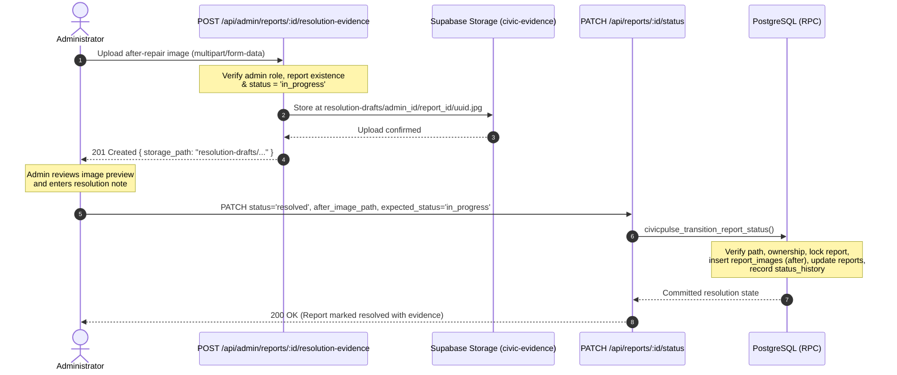

# CivicPulse: Resolution Evidence & Proof-Aware Workflow Contract (Phase 17)

> **Document Version**: 1.0.0  
> **Status**: Verified & Integrated  
> **Backend Branch**: `backend`  

---

## 1. Executive Summary & Overview

Phase 17 implements the **Proof-Aware Resolution Workflow** for civic complaints. When administrators complete remediation on an infrastructure issue, they upload after-repair photographic evidence and finalize the status transition to `resolved`.

### Key Policies:
1. **Mandatory Resolution Evidence**: Any new transition to `resolved` strictly requires an administrator-uploaded after-repair photograph (`after_image_path`). Requests lacking this evidence are rejected with HTTP 422 `VALIDATION_ERROR`.
2. **Admin-Only Upload**: Citizens can only upload `before` complaint evidence. Only verified administrators can stage official `after` resolution evidence.
3. **Atomic Consistency**: Status change (`reports.status = 'resolved'`), resolved timestamp (`reports.resolved_at`), immutable audit record (`status_history`), and evidence linkage (`report_images`) commit in a single PostgreSQL transaction.
4. **Truthful Labeling**: Photographic evidence is described accurately as *"Marked resolved by an administrator with after-repair evidence"*. CivicPulse never claims independent municipal inspection or certified government verification.
5. **Legacy Report Exception**: Historical complaints resolved prior to Phase 17 that lack after-repair photographs remain valid; evidence is not retroactively fabricated.

---

## 2. API Endpoints Reference

| Method | Endpoint | Auth Required | Purpose |
| :--- | :--- | :--- | :--- |
| `POST` | `/api/admin/reports/:id/resolution-evidence` | Admin Only | Upload an after-repair evidence photograph to private resolution staging |
| `PATCH` | `/api/reports/:id/status` | Admin Only | Atomically finalize status to `resolved` with `after_image_path` |
| `GET` | `/api/reports/:id/evidence` | Public / Contextual | Retrieve before and after photographs with short-lived signed URLs |

---

## 3. Two-Step Resolution Sequence



---

## 4. Endpoint Specifications

### 4.1 Upload Resolution Evidence (`POST /api/admin/reports/:id/resolution-evidence`)

#### Request:
- **Content-Type**: `multipart/form-data`
- **Field**: `file` (Binary image file: JPEG, PNG, or WebP; max 3 MB)
- **Path Parameter**: `:id` (UUID v4 of target report in `in_progress` status)

#### Response (`HTTP 201 Created`):
```json
{
  "data": {
    "bucket": "civic-evidence",
    "storage_path": "resolution-drafts/22222222-2222-4222-8222-222222222222/44444444-4444-4444-8444-444444444444/3a7b9c1d-8e2f-4a5b-9c3d-1e2f3a4b5c6d.jpg",
    "mime_type": "image/jpeg",
    "size_bytes": 1048576,
    "status": "temporary"
  },
  "error": null
}
```

---

### 4.2 Finalize Complaint Resolution (`PATCH /api/reports/:id/status`)

#### Request:
- **Content-Type**: `application/json`
- **Body**:
  ```json
  {
    "status": "resolved",
    "expected_status": "in_progress",
    "after_image_path": "resolution-drafts/22222222-2222-4222-8222-222222222222/44444444-4444-4444-8444-444444444444/3a7b9c1d-8e2f-4a5b-9c3d-1e2f3a4b5c6d.jpg",
    "notes": "Pothole filled with permanent asphalt patch and leveled with road surface."
  }
  ```

#### Response (`HTTP 200 OK`):
```json
{
  "data": {
    "id": "44444444-4444-4444-8444-444444444444",
    "previous_status": "in_progress",
    "status": "resolved",
    "updated_at": "2026-11-21T18:30:00.000Z",
    "resolved_at": "2026-11-21T18:30:00.000Z",
    "history_entry_id": "hist-uuid-777",
    "version": 3,
    "resolution_evidence": {
      "image_id": "img-after-uuid-888",
      "storage_path": "resolution-drafts/22222222-2222-4222-8222-222222222222/44444444-4444-4444-8444-444444444444/3a7b9c1d-8e2f-4a5b-9c3d-1e2f3a4b5c6d.jpg",
      "type": "after"
    }
  },
  "error": null
}
```

---

### 4.3 Retrieve Before and After Evidence (`GET /api/reports/:id/evidence`)

#### Query Parameters:
- `expires_in`: number (optional, seconds for signed URL expiration; min 60, max 3600, default 900)

#### Response (`HTTP 200 OK`):
```json
{
  "data": {
    "report_id": "44444444-4444-4444-8444-444444444444",
    "status": "resolved",
    "resolved_at": "2026-11-21T18:30:00.000Z",
    "attribution_notice": "Marked resolved by an administrator with after-repair evidence.",
    "before_images": [
      {
        "id": "img-before-1",
        "storage_path": "drafts/11111111-1111-4111-8111-111111111111/abc.jpg",
        "type": "before",
        "created_at": "2026-11-20T10:00:00.000Z",
        "signed_url": "https://<project>.supabase.co/storage/v1/object/sign/civic-evidence/drafts/...?token=..."
      }
    ],
    "after_images": [
      {
        "id": "img-after-1",
        "storage_path": "resolution-drafts/22222222-2222-4222-8222-222222222222/44444444-4444-4444-8444-444444444444/3a7b9c1d.jpg",
        "type": "after",
        "created_at": "2026-11-21T18:30:00.000Z",
        "signed_url": "https://<project>.supabase.co/storage/v1/object/sign/civic-evidence/resolution-drafts/...?token=..."
      }
    ]
  },
  "error": null
}
```

---

## 5. Frontend Admin Resolution Form Guide

```typescript
// 1. Upload After-Repair Photo
export async function uploadResolutionPhoto(reportId: string, file: File): Promise<string> {
  const formData = new FormData();
  formData.append("file", file);

  const res = await fetch(`/api/admin/reports/${reportId}/resolution-evidence`, {
    method: "POST",
    body: formData,
    credentials: "include",
  });

  const json = await res.json();
  if (!res.ok) throw new Error(json.error?.message || "Failed to upload after photo");
  return json.data.storage_path;
}

// 2. Submit Final Resolution
export async function finalizeResolution(
  reportId: string,
  afterImagePath: string,
  notes?: string
) {
  const res = await fetch(`/api/reports/${reportId}/status`, {
    method: "PATCH",
    headers: { "Content-Type": "application/json" },
    body: JSON.stringify({
      status: "resolved",
      expected_status: "in_progress",
      after_image_path: afterImagePath,
      notes,
    }),
    credentials: "include",
  });

  const json = await res.json();
  if (!res.ok) throw new Error(json.error?.message || "Failed to finalize resolution");
  return json.data;
}
```
